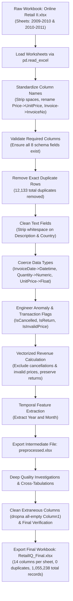

# RetailIQ – Python, Power BI & Data Science

An end-to-end retail business intelligence and data science project analyzing multi-year transactional retail data using **Python**, **Power BI**, and **Advanced Analytics**.

---

## Table of Contents
- [1. Project Overview](#1-project-overview)
- [2. Project Objectives](#2-project-objectives)
- [3. Dataset Overview & Source](#3-dataset-overview--source)
- [4. Technology Stack](#4-technology-stack)
- [5. Project Directory Structure](#5-project-directory-structure)
- [6. Data Preprocessing Workflow](#6-data-preprocessing-workflow)
- [7. Implementation vs. Investigations vs. Decisions](#7-implementation-vs-investigations-vs-decisions)
- [8. Data Quality Findings & Validation Results](#8-data-quality-findings--validation-results)
- [9. Final Dataset Statistics](#9-final-dataset-statistics)
- [10. Current Project Status](#10-current-project-status)
- [11. Upcoming Stages](#11-upcoming-stages)
- [12. Exploratory Data Analysis (EDA)](#12-exploratory-data-analysis-eda)
  - [12.1 EDA Overview & Objectives](#121-eda-overview--objectives)
  - [12.2 Cross-Sheet Deduplication & Dataset Dimensions](#122-cross-sheet-deduplication--dataset-dimensions)
  - [12.3 Summary of Eight Core EDA Tasks](#123-summary-of-eight-core-eda-tasks)
  - [12.4 Key Analytical Findings & Business Insights](#124-key-analytical-findings--business-insights)
  - [12.5 Customer RFM Segmentation Analysis](#125-customer-rfm-segmentation-analysis)
  - [12.6 Product Performance, Growth & Decline](#126-product-performance-growth--decline)
  - [12.7 Geographic Performance & Wholesale Dynamics](#127-geographic-performance--wholesale-dynamics)
  - [12.8 Temporal Trends & Trading Velocity](#128-temporal-trends--trading-velocity)
  - [12.9 Cancellations, Returns & Anomaly Diagnostics](#129-cancellations-returns--anomaly-diagnostics)
  - [12.10 Revenue Validation Methodology](#1210-revenue-validation-methodology)
  - [12.11 Analytical Limitations & Interpretation Cautions](#1211-analytical-limitations--interpretation-cautions)
  - [12.12 Link to EDA Notebook](#1212-link-to-eda-notebook)

---

## 1. Project Overview

**RetailIQ** is an enterprise-grade analytics project designed to turn raw transactional e-commerce data into actionable business intelligence. The dataset encompasses international transactions from a UK-based online retail business across two consecutive operational years (2009–2010 and 2010–2011).

The project combines rigorous, verifiable data preprocessing, feature engineering, and exploratory data analysis (EDA) using Python, establishing a validated data foundation for customer segmentation (RFM), statistical modeling, and interactive Power BI executive dashboards.

---

## 2. Project Objectives

- **Data Integrity & Normalization**: Standardize inconsistent schemas across multi-year sheets, eliminate duplicate records, format data types, and normalize textual fields.
- **Transaction & Anomaly Classification**: Accurately detect and flag order cancellations, product returns, zero-price items, and accounting balance adjustments without destroying audit trails.
- **Accurate Financial Modeling**: Establish robust business rules for revenue calculation that correctly account for refunds and cancellations while isolating invalid transactions.
- **Comprehensive Exploratory Data Analysis**: Evaluate multi-year sales velocity, seasonality surges, customer retention behaviors, product performance lifecycles, and geographic expansion patterns.
- **Enterprise-Grade Documentation**: Provide reproducible preprocessing pipelines, transparent audit metrics, and clear tracking of data-cleaning rationales.
- **Downstream BI & Analytics Readiness**: Output clean, validated data structures optimized for customer segmentation (RFM), cohort retention modeling, and interactive Power BI executive dashboards.

---

## 3. Dataset Overview & Source

The dataset used in this project is the widely recognized **Online Retail II** dataset, sourced from the **UCI Machine Learning Repository**:
- **Source**: [UCI Machine Learning Repository: Online Retail II](https://archive.ics.uci.edu/dataset/502/online+retail+ii)
- **Timeframe**: 01/12/2009 to 09/12/2011 (2 distinct annual operational cycles).
- **Domain**: E-commerce / Giftware & Wholesaler transactions based in the United Kingdom, serving both domestic and international wholesale/retail clients.
- **Storage Format**: Excel Workbook (`.xlsx`) containing two yearly worksheets:
  - `Year 2009-2010`: Transactions from December 1, 2009 to December 9, 2010.
  - `Year 2010-2011`: Transactions from December 1, 2010 to December 9, 2011.

### Raw Data Schema:
| Column | Raw Type | Description |
|---|---|---|
| `Invoice` | Object / String | 6-digit invoice number. If the code starts with 'C', it indicates a cancellation. |
| `StockCode` | Object / String | 5-digit product code, occasionally followed by letter suffixes or operational codes. |
| `Description` | Object / String | Product/item name. |
| `Quantity` | Integer | Quantities of each product per transaction. |
| `InvoiceDate` | Datetime / Object | The day and time when each transaction was generated. |
| `Price` | Float | Product unit price in sterling (£). |
| `Customer ID` | Float / Object | 5-digit customer number identifier. |
| `Country` | Object / String | Country of client residence. |
| `Column1` | Object (Sheet 2 only)| Extraneous, entirely empty column present in the raw 2010–2011 worksheet. |

---

## 4. Technology Stack

- **Data Processing & Scripting**: Python 3.10+, Jupyter Notebook (`preprocessing.ipynb`, `eda.ipynb`)
- **Core Libraries**:
  - `pandas`: Vectorized manipulation, data cleaning, datetime parsing, cross-tabulation, aggregation.
  - `numpy`: Conditional vectorized logic (`np.where`, `np.isclose`).
  - `matplotlib`: Data visualization, trend plots, distribution histograms.
  - `openpyxl`: Excel reading and multi-sheet writing engine.
- **Version Control & Repository Management**: Git, GitHub
- **Planned BI & Visualization**: Power BI Desktop (DAX, Power Query, Data Modeling)

---

## 5. Project Directory Structure

```text
retailiq-python-powerbi-datascience/
│
├── .gitignore               # Ignored build artifacts, checkpoints, and OS/Excel lock files
├── README.md                # Comprehensive project documentation (this file)
├── preprocessing.ipynb      # Complete, reproducible Python preprocessing notebook
├── eda.ipynb                # Comprehensive Exploratory Data Analysis (EDA) notebook
│
├── Online Retail II.xlsx    # Original raw multi-sheet Excel dataset (UCI Repository)
├── preprocessed.xlsx        # Intermediate preprocessing output (flagged, standardized)
└── RetailIQ_Final.xlsx      # Final validated production dataset (cleaned, verified schema)
```

---

## 6. Data Preprocessing Workflow

The preprocessing pipeline implemented in `preprocessing.ipynb` follows a modular and strictly validated approach across both annual worksheets:



### Detailed Pipeline Steps:
1. **Multi-Sheet Ingestion**: Both `Year 2009-2010` and `Year 2010-2011` are ingested dynamically via `pd.read_excel(file_path, sheet_name=None)`.
2. **Column Normalization**:
   - Stripped leading/trailing spaces and internal spaces: `df.columns = df.columns.astype(str).str.strip().str.replace(" ", "", regex=False)`.
   - Renamed `Customer ID` to `CustomerID`, `Invoice` to `InvoiceNo`, and `Price` to `UnitPrice`.
   - Validated schema compliance against required column specifications.
3. **Deduplication**: Executed `df.drop_duplicates(inplace=True)` on each sheet.
4. **Text Sanitization**: Coerced `Description` and `Country` to nullable strings and stripped excess padding.
5. **Type Coercion**:
   - `InvoiceDate` converted to `datetime64[ns]` with error coercion.
   - `Quantity` converted to numeric integer format.
   - `UnitPrice` converted to 64-bit floating point.
6. **Transaction & Anomaly Flagging**:
   - `IsCancelled`: Boolean flag identifying order cancellations where `InvoiceNo.str.startswith("C")`.
   - `IsReturn`: Boolean flag identifying negative volume where `Quantity < 0`.
   - `IsInvalidPrice`: Boolean flag identifying zero or negative unit costs where `UnitPrice <= 0`.
7. **Vectorized Revenue Computation**:
   Implemented conditional business logic:
   $$\text{Revenue} = \begin{cases} \text{Quantity} \times \text{UnitPrice} & \text{if } \neg\text{IsCancelled} \wedge \text{UnitPrice} > 0 \wedge \text{Quantity is not null} \\ 0 & \text{otherwise} \end{cases}$$
   *Note: For legitimate non-cancelled customer returns ($\text{Quantity} < 0$), revenue computes as negative, accurately recording refund debits.*
8. **Date Part Extraction**: Computed `Year` and `Month` directly from `InvoiceDate`.
9. **Schema Finalization**:
   - Dropped entirely empty columns (`df.dropna(axis=1, how="all")`), cleanly eliminating the raw artifact `Column1` from `Year 2010-2011`.
   - Exported both processed sheets into `RetailIQ_Final.xlsx`.

---

## 7. Implementation vs. Investigations vs. Decisions

To maintain analytical rigor, the project separates programmatic execution from exploratory audits and business retention rules:

### A. Operations Implemented in Code
- Automated column renaming and space stripping.
- Systematic full-row deduplication across both sheets.
- Text trimming on `Description` and `Country`.
- Type casting (`datetime64[ns]`, `float64`, `int64`, `boolean`).
- Algorithmic generation of `IsCancelled`, `IsReturn`, `IsInvalidPrice`, `Revenue`, `Year`, and `Month`.
- Automated dropping of entirely null columns (`Column1`).
- Multi-sheet Excel workbook export (`preprocessed.xlsx` and `RetailIQ_Final.xlsx`).

### B. Data-Quality Investigations Performed
- **StockCode Distribution**: Evaluated numeric codes vs. alphanumeric suffixes (e.g., `85123A`, `POST`, `D` [Discount], `M` [Manual], `S` [Samples], `B` [Bad Debt]).
- **Zero-Price Root Cause Analysis**: Discovered that zero-price lines represent inventory write-offs, damaged stock, unexplainable losses, warehouse checks, and promotional samples.
- **Negative-Price Analysis**: Identified exactly 5 records across both years with negative unit prices, all tied to `StockCode: B` with description `"Adjust bad debt"`.
- **Cancellation vs. Return Overlap**: Discovered that while most negative quantities are flagged with an invoice `'C'` prefix, thousands of return transactions (`2,121` in 09–10; `1,336` in 10–11) have standard invoice numbers.
- **CustomerID vs. UnitPrice Crosstab**: Verified that ~98% of zero-price records lack a `CustomerID`, but a small subset (31 in 09–10; 40 in 10–11) belong to registered customer accounts.

### C. Strategic Cleaning Decisions & Rationale
Contrary to naive data-cleaning practices that delete any row containing missing or negative values, **records were deliberately retained** based on explicit business logic:

1. **Retaining Missing `CustomerID` (107,833 in 09–10; 135,037 in 10–11)**:
   - *Rationale*: These rows represent guest checkouts and anonymous online shoppers. Deleting them would artificially erase over £3.6M+ in legitimate sales revenue and severely skew market basket analysis. They are retained for sales, revenue, and product analytics, but will be isolated during customer-level (RFM) modeling.
2. **Retaining Missing `Description` (2,928 in 09–10; 1,454 in 10–11)**:
   - *Rationale*: All missing descriptions coincide with zero-price administrative adjustments and missing customer IDs. Retaining them preserves the raw transaction count for operational auditing.
3. **Retaining Zero-Price Transactions (`UnitPrice == 0`) (3,681 in 09–10; 2,510 in 10–11)**:
   - *Rationale*: Zero-price rows represent operational events (damages, inventory lost, samples). They are flagged via `IsInvalidPrice` and assigned `0` revenue to prevent financial distortion while retaining data for supply chain/loss auditing.
4. **Retaining Negative Quantities (`Quantity < 0`) (12,302 in 09–10; 10,587 in 10–11)**:
   - *Rationale*: Negative quantities represent genuine product returns and reverse logistics. Retaining them allows for the calculation of return rates, return volumes, and net revenue.
5. **Retaining Negative-Price Bad Debt Records (`UnitPrice < 0`) (3 in 09–10; 2 in 10–11)**:
   - *Rationale*: Invoices starting with `A` (e.g., `A506401`, `A563186`) denote corporate bad debt accounting adjustments (e.g., -£53,594.36). Assigned `0` revenue via our business rule to avoid corrupting top-line commercial turnover while retaining ledger traceability.

> [!NOTE]
> **Dataset Cleanliness Notice**: The final dataset is **not** completely free of missing values or negative entries. It is a structured, flagged, and audited representation that preserves business realities while preventing calculation errors.

---

## 8. Data Quality Findings & Validation Results

### Metric Verification Summary

| Metric / Audit Parameter | Year 2009–2010 | Year 2010–2011 | Combined Total |
|---|---:|---:|---:|
| **Initial Raw Records** | 525,461 | 541,910 | 1,067,371 |
| **Duplicate Records Removed** | 6,865 | 5,268 | 12,133 |
| **Final Preprocessed Records** | **518,596** | **536,642** | **1,055,238** |
| **Total Columns** | 14 | 14 | 14 |
| **Duplicate Records in Final File** | **0** | **0** | **0** |
| **Missing CustomerID** | 107,833 | 135,037 | 242,870 |
| **Missing Description** | 2,928 | 1,454 | 4,382 |
| **Zero UnitPrice (`UnitPrice == 0`)** | 3,681 | 2,510 | 6,191 |
| **Negative UnitPrice (`UnitPrice < 0`)** | 3 | 2 | 5 |
| **Total Invalid Prices (`IsInvalidPrice`)** | 3,684 | 2,512 | 6,196 |
| **Negative Quantity (`Quantity < 0`)** | 12,302 | 10,587 | 22,889 |
| **Cancelled Invoices (`IsCancelled`)** | 10,182 | 9,251 | 19,433 |
| **Total Calculated Revenue (£)** | **10,271,762.664** | **10,642,128.804** | **20,913,891.468** |

*Financial Reconciliation Note: Exact sum of validated worksheet revenues: £10,271,762.664 + £10,642,128.804 = **£20,913,891.468**.*

### Revenue Validation Check
An automated audit was executed in `preprocessing.ipynb` comparing the stored `Revenue` column against an independently computed formula:
$$\Delta = |\text{Revenue}_{\text{actual}} - \text{Revenue}_{\text{expected}}|$$
- **Revenue Mismatches (> 0.001)**: **0** across all 1,055,238 rows.
- **Cancelled Invoices Revenue**: Exactly **£0.00**.
- **Negative Price Adjustments Revenue**: Exactly **£0.00**.

---

## 9. Final Dataset Statistics

The production dataset is stored in `RetailIQ_Final.xlsx` across two sheets:
- **Sheet 1**: `Year 2009-2010` (518,596 rows, 14 columns)
- **Sheet 2**: `Year 2010-2011` (536,642 rows, 14 columns)

### Final Schema (14 Columns):
1. `InvoiceNo` (*string/object*): Unique identifier for each order (6 digits, or 'C'/'A' prefix).
2. `StockCode` (*string/object*): Unique identifier for each distinct product or service.
3. `Description` (*string*): Cleaned item name.
4. `Quantity` (*integer*): Units sold or returned.
5. `InvoiceDate` (*datetime64*): Timestamp of transaction.
6. `UnitPrice` (*float64*): Unit price per product in GBP (£).
7. `CustomerID` (*float64*): Unique client identifier.
8. `Country` (*string*): Destination/residence country.
9. `IsCancelled` (*boolean*): `True` if `InvoiceNo` begins with `'C'`.
10. `IsReturn` (*boolean*): `True` if `Quantity < 0`.
11. `IsInvalidPrice` (*boolean*): `True` if `UnitPrice <= 0`.
12. `Revenue` (*float64*): Validated financial revenue contribution in GBP (£).
13. `Year` (*integer*): Extracted calendar year.
14. `Month` (*integer*): Extracted calendar month (1–12).

---

## 10. Current Project Status

- [x] Comprehensive review of raw retail transaction data.
- [x] Schema harmonization across multi-year sheets.
- [x] Full deduplication (12,133 duplicate records removed across sheets).
- [x] Anomaly identification and categorical flagging (`IsCancelled`, `IsReturn`, `IsInvalidPrice`).
- [x] Financial revenue engineering and zero-mismatch validation.
- [x] Intermediate (`preprocessed.xlsx`) and production (`RetailIQ_Final.xlsx`) file generation.
- [x] Exploratory Data Analysis (EDA) on corrected deduplicated multi-year dataset (`eda.ipynb`).
- [x] Cross-sheet overlap resolution (removing 22,202 cross-sheet duplicates).
- [x] Corrected Customer RFM segmentation across 5,881 identified accounts.
- [x] Product growth, decline, and Pareto revenue contribution analysis.
- [x] Temporal, weekday, and hourly transaction pattern analysis.
- [x] Return and cancellation mechanics audit with floating-point revenue validation.
- [x] Complete project documentation and GitHub repository publication.

---

## 11. Upcoming Stages

1. **Stage 3: Advanced Customer Analytics & Machine Learning**
   - **Cohort Retention Modeling**: Tracking customer repurchase behaviors over time.
   - **Customer Lifetime Value (CLV) Prediction**: Quantifying future net revenue per customer segment.
   - **Market Basket Analysis**: Association rule mining (Apriori / FP-Growth) to discover cross-selling opportunities.
2. **Stage 4: Power BI Enterprise Dashboard Development**
   - Star schema data modeling (Fact Sales, Dim Date, Dim Customer, Dim Product, Dim Geography).
   - Advanced DAX metrics: Year-over-Year (YoY) growth, Month-over-Month (MoM) sales velocity, Customer Lifetime Value (CLV), Return Rate %.
   - Interactive executive reporting: Executive Summary, Customer Deep Dive, Product Performance, and Operational Anomaly Tracker.

---

## 12. Exploratory Data Analysis (EDA)

### 12.1 EDA Overview & Objectives
The Exploratory Data Analysis phase, executed in [eda.ipynb](eda.ipynb), investigates the multi-year transactional dynamics of the business across the two operational periods (2009–2010 and 2010–2011).

The core objectives of the EDA were:
1. Assess multi-year revenue trends, order velocity, and average order value (AOV) dynamics.
2. Uncover customer engagement patterns and perform behavioral segmentation using Recency, Frequency, and Monetary (RFM) modeling.
3. Quantify product sales concentration, identify top revenue contributors, and diagnose high-growth vs. declining SKUs.
4. Map international revenue distribution and contrast domestic retail versus international wholesale order profiles.
5. Identify recurring temporal purchase behaviors across seasonal months, days of the week, and hours of the day.
6. Scrutinize cancellation rates, return volumes, and operational adjustments to prevent analytical misinterpretation.
7. Conduct deep stress-testing of numerical distributions, extreme transactions, and floating-point revenue calculations.

---

### 12.2 Cross-Sheet Deduplication & Dataset Dimensions

A critical structural discovery made during the EDA was the presence of **cross-sheet duplicate records** between the two yearly files. 

While each sheet was individually deduplicated during initial preprocessing, the two annual periods shared an overlapping reporting window between **December 1, 2010 and December 9, 2010**:
- **Overlapping Invoice Numbers**: **1,088** unique invoice IDs appeared in both sheets.
- **Identical Records in Year 2009–2010**: **22,202** rows.
- **Identical Records in Year 2010–2011**: **22,202** rows.
- **Exact Inner-Merge Duplication**: Exactly **22,202** records were identical across all 14 columns.

```python
# Cross-sheet deduplication implementation (eda.ipynb, Cell 4)
df_combined = pd.concat([df1, df2], ignore_index=True)
df_combined = df_combined.drop_duplicates().reset_index(drop=True)
```

#### Final Dimensions & Volume Reconciliation:
- **Naive Combined Rows**: $518,596 + 536,642 = 1,055,238$ rows (Revenue: £20,913,891.47)
- **Cross-Sheet Duplicates Removed**: **22,202** rows
- **Corrected Combined Records**: **1,033,036** rows
- **Remaining Duplicate Records**: **0**
- **Corrected Combined Revenue**: **£20,476,260.45**
- **Corrected Non-Cancelled Orders**: **45,336**
- **Corrected Net Quantity Sold**: **10,409,779** units
- **Corrected Average Order Value (AOV)**: **£451.66**

---

### 12.3 Summary of Eight Core EDA Tasks

The exploration in [eda.ipynb](eda.ipynb) systematically addressed eight key analytical domains:

1. **Dataset Overview**: Evaluated total dimensions, date ranges (2009-12-01 to 2011-12-09), unique invoice counts (53,628), unique product SKUs (5,305), unique customer profiles (5,942), and international markets (43 countries).
2. **Sales Performance Analysis**: Evaluated annual revenue, non-cancelled order volume, net quantity, and Average Order Value (AOV), tracking a 3.61% revenue increase between periods.
3. **Customer Analysis & Recalculated RFM**: Evaluated customer concentration, order frequency, and engineered an RFM segmentation model across 5,881 active accounts with valid IDs.
4. **Product Analysis**: Assessed revenue and quantity distributions by StockCode, top 10 revenue concentration (10.29%), and evaluated annual SKU growth and decline trajectories.
5. **Country Analysis**: Profiled domestic UK versus international market contributions, discovering high international wholesale AOVs in the Netherlands, Singapore, and Australia.
6. **Time-Based Analysis**: Extracted and evaluated monthly seasonality curves, active-day weekday averages, and hourly trading volume distributions.
7. **Returns & Cancellation Analysis**: Analyzed 8,292 cancelled orders (15.46% cancellation rate) and established that non-cancelled negative quantity entries were zero-price operational adjustments.
8. **Data Quality & Anomaly Analysis**: Evaluated extreme wholesale quantities/cancellations, bad debt accounting adjustments, and verified financial calculations using tolerance-based precision (`np.isclose()`).

---

### 12.4 Key Analytical Findings & Business Insights

| Dimension / Metric | Year 2009–2010 | Year 2010–2011 | Corrected Combined |
|---|---:|---:|---:|
| **Total Records** | 518,596 | 536,642 | **1,033,036** |
| **Total Revenue (£)** | £10,271,762.66 | £10,642,128.80 | **£20,476,260.45** |
| **Valid Orders (excl. Cancellations)** | 24,224 | 22,064 | **45,336** |
| **Total Quantity Sold** | 5,413,184 | 5,162,503 | **10,409,779** |
| **Average Order Value (AOV)** | £424.03 | £482.33 | **£451.66** |
| **Unique Active Customers** | 4,383 | 4,372 | **5,942** |
| **Unique Product SKUs** | 4,632 | 4,070 | **5,305** |
| **Unique Operating Countries** | 40 | 38 | **43** |
| **Cancellation Rate (%)** | 15.94% | 14.81% | **15.46%** |
| **Top 10 Customer Revenue Share** | 16.50% | 17.30% | **16.04%** |
| **Top 10 Product Revenue Share** | — | — | **10.29%** |
| **UK Revenue Contribution (%)** | 85.79% | 84.59% | **85.03%** |

#### Key Business Takeaways:
1. **Steady Top-Line Expansion**: Revenue grew by **3.61%** between the two annual cycles (+£370,366.14). While total order counts slightly contracted (-8.9%), this was compensated by a **13.7% increase in Average Order Value** (£424.03 to £482.33).
2. **Q4 Holiday Seasonality Spike**: In both annual cycles, **November** represented the single highest revenue month (£1,464,293.14 in 2010; £1,503,866.78 in 2011), exhibiting strong retail pre-holiday inventory buildup.
3. **High Customer Spend Concentration**: The top 10 identified customers accounted for **£2,787,079.44** (16.04%) of all identified customer revenue. Customer #18102.0 was the largest client, generating £580,987.04 across 145 orders.
4. **Dominant Domestic Core with High-Value Export Pockets**: The United Kingdom generated **85.03%** of total revenue. However, international export markets operated primarily on wholesale models with much higher basket sizes.

---

### 12.5 Customer RFM Segmentation Analysis

Customer segmentation was conducted on the **corrected deduplicated combined dataset** for all **5,881 unique customers** with valid customer IDs and completed orders. 

- **Recency ($R$)**: Days between the customer's last purchase and the reference date (December 10, 2011; 1 day after the latest recorded transaction).
- **Frequency ($F$)**: Count of unique non-cancelled invoice orders.
- **Monetary ($M$)**: Sum of net revenue generated by the customer.

Quintile scores (1 to 5) were generated via rank percentiles to prevent quantization distortions from discrete frequency ties.

#### Segment Definitions and Distribution:

| Customer Segment | Criteria / Score Rule | Customer Count | Percentage (%) | Behavioral Profile & Recommended Strategy |
|---|---|---:|---:|---|
| **Hibernating** | $R \le 2 \wedge F \le 2$ | 1,646 | 27.99% | Inactive customers with low historical engagement. Low-cost automated email re-activation or clearance promotions. |
| **Champions** | $R \ge 4 \wedge F \ge 4 \wedge M \ge 4$ | 1,274 | 21.66% | Top-tier shoppers who buy frequently, recently, and spend heavily. Priority support, early access, and loyalty rewards. |
| **Loyal Customers** | $F \ge 4$ (not Champion) | 887 | 15.08% | Consistent repeat purchasers. Upsell higher-margin product bundles and cross-sell related categories. |
| **Potential Loyalists** | $R \ge 4 \wedge F \ge 2$ | 712 | 12.11% | Recent shoppers with repeat activity. Introduce membership incentives and loyalty tier progression. |
| **Need Attention** | $R == 3 \wedge F \le 3$ | 698 | 11.87% | Moderate recency and frequency who are at risk of drifting into dormancy. Targeted discount reminders. |
| **At Risk** | $R \le 2 \wedge F \ge 3$ | 424 | 7.21% | Former frequent buyers who have not purchased recently. Win-back campaigns and satisfaction surveys. |
| **Others** | Non-standard combinations | 164 | 2.79% | Irregular or specialized buying patterns requiring individual evaluation. |
| **New Customers** | $R == 5 \wedge F == 1$ | 76 | 1.29% | First-time recent purchasers. Onboarding nurture sequences to drive the critical second purchase. |
| **Total** | | **5,881** | **100.00%** | |

> [!IMPORTANT]
> **RFM Methodology Rule**: These published RFM figures represent the recalculated segmentation on the deduplicated dataset (5,881 accounts). They exclude guest checkouts (missing `CustomerID`), which are analyzed independently in aggregate sales models.

---

### 12.6 Product Performance, Growth & Decline

Product revenue and unit sales were analyzed by `StockCode` and cleaned `Description`:

#### Top 10 Revenue-Generating SKUs (Combined):
1. **`M` (Manual)**: £339,226.24 (Special service/custom orders)
2. **`22423` (REGENCY CAKESTAND 3 TIER)**: £330,590.32
3. **`DOT` (DOTCOM POSTAGE)**: £309,854.11 (Online order postage charges)
4. **`85123A` (WHITE HANGING HEART T-LIGHT HOLDER)**: £257,724.71
5. **`85099B` (JUMBO BAG RED RETROSPOT)**: £180,569.34
6. **`23843` (PAPER CRAFT , LITTLE BIRDIE)**: £168,469.60
7. **`47566` (PARTY BUNTING)**: £148,318.28
8. **`84879` (ASSORTED COLOUR BIRD ORNAMENT)**: £129,324.49
9. **`POST` (POSTAGE)**: £125,682.42
10. **`22086` (PAPER CHAIN KIT 50'S CHRISTMAS)**: £117,760.29

*The top 10 products account for **10.29%** (£2,107,519.80) of total business revenue.*

#### Top Products by Net Quantity Sold:
1. **`84077` (WORLD WAR 2 GLIDERS ASSTD DESIGNS)**: 104,546 units
2. **`85099B` (JUMBO BAG RED RETROSPOT)**: 94,151 units
3. **`85123A` (WHITE HANGING HEART T-LIGHT HOLDER)**: 94,123 units
4. **`21212` (PACK OF 72 RETROSPOT CAKE CASES)**: 93,774 units
5. **`84879` (ASSORTED COLOUR BIRD ORNAMENT)**: 78,978 units

#### Product Growth & Decline Analysis (Period-over-Period):
- **Fastest Growing Products**:
  - `23843` (PAPER CRAFT, LITTLE BIRDIE): +£168,469.60 (New product breakout in 2010–2011).
  - `DOT` (DOTCOM POSTAGE): +£89,840.06 (+77.18% growth, reflecting expanding web retail fulfillment).
  - `23166` (MEDIUM CERAMIC TOP STORAGE JAR): +£81,700.92 (New introduction).
  - `23084` (RABBIT NIGHT LIGHT): +£66,870.03 (New introduction).
  - `47566` (PARTY BUNTING): +£49,781.11 (+100.24% growth).
- **Fastest Declining Products**:
  - `M` (Manual): -£184,827.09 (-70.39%, indicating tighter operational standardization and fewer manual invoice overrides).
  - `85123A` (WHITE HANGING HEART T-LIGHT HOLDER): -£53,842.97 (-34.01% decline from its 09–10 high).
  - `37503`: -£25,428.33 (-100.00%, discontinued).
  - `21843` (RED RETROSPOT CAKE STAND): -£23,639.95 (-52.54%).

---

### 12.7 Geographic Performance & Wholesale Dynamics

The business delivered to **43 distinct countries** across the two-year operational history:

```text
Top 10 Markets by Revenue Share:
1. United Kingdom : £17,410,196.12 (85.03%) | 41,793 Orders
2. EIRE           : £   658,767.31 ( 3.22%) |    626 Orders
3. Netherlands    : £   554,038.09 ( 2.71%) |    229 Orders
4. Germany        : £   425,019.71 ( 2.08%) |    789 Orders
5. France         : £   350,456.09 ( 1.71%) |    622 Orders
6. Australia      : £   169,283.46 ( 0.83%) |     95 Orders
7. Spain          : £   108,332.49 ( 0.53%) |    154 Orders
8. Switzerland    : £   100,685.59 ( 0.49%) |     94 Orders
9. Sweden         : £    91,869.82 ( 0.45%) |    105 Orders
10. Denmark       : £    68,580.69 ( 0.33%) |     43 Orders
```

#### Domestic Retail vs. International Wholesale Profile:
While the United Kingdom dominates overall sales volume, international markets exhibit much higher **Average Order Value (AOV)**, indicating a B2B / wholesale export model:
- **Netherlands**: AOV of **£2,419.38** (229 orders generating £554,038.09) — nearly 6x higher than the UK AOV.
- **Singapore**: AOV of **£2,301.55** (11 orders).
- **Australia**: AOV of **£1,781.93** (95 orders).
- **Denmark**: AOV of **£1,594.90** (43 orders).
- **Hong Kong**: AOV of **£1,579.03** (15 orders).
- **United Kingdom**: AOV of **£416.58** (41,793 orders generating £17,410,196.12), representing a blend of retail and small commercial accounts.

---

### 12.8 Temporal Trends & Trading Velocity

#### 1. Monthly Seasonality:
- **Peak Trading Period**: October and November consistently represent annual peaks.
  - November 2010: £1,464,293.14
  - November 2011: £1,503,866.78
- **Post-Holiday Trough**: January and February experience sharp cyclical downturns (February 2010: £551,504.73; February 2011: £522,545.56) due to retailer inventory exhaustion and post-Christmas consumer fatigue.

#### 2. Day-of-Week Shopping Patterns:
Transactions were aggregated by day of the week across active dates:
- **Thursday** is the highest grossing day: **£4,195,212.76** total revenue (Average Daily Revenue: **£40,730.22** across 103 active days).
- **Tuesday**: **£4,078,149.96** total revenue (Average Daily Revenue: **£39,212.98** across 104 active days).
- **Monday**: **£3,581,594.18** total revenue (Average Daily Revenue: **£38,102.07** across 94 active days).
- **Wednesday**: **£3,488,444.33** total revenue (Average Daily Revenue: **£33,542.73** across 104 active days).
- **Friday**: **£3,323,908.88** total revenue (Average Daily Revenue: **£33,574.84** across 99 active days).
- **Sunday**: **£1,799,147.28** total revenue (Average Daily Revenue: **£18,173.20** across 99 active days).
- **Saturday**: Operating schedule anomaly — only **1 single Saturday** recorded transactions (£9,803.05), confirming that the warehouse and fulfillment facilities are closed on Saturdays.

#### 3. Hourly Sales Velocity:
Analyzing trading volume by hour reveals that sales follow a bell curve centered around business operating hours:
- **Peak Trading Window**: 10:00 AM to 3:00 PM.
- **Top Hour**: **12:00 PM (Noon)** generated **£2,850,377.67**, followed by **10:00 AM** (£2,581,131.33) and **1:00 PM** (£2,548,467.54).
- Off-hours (before 7:00 AM and after 6:00 PM) account for negligible turnover, aligning with corporate/wholesale procurement schedules.

---

### 12.9 Cancellations, Returns & Anomaly Diagnostics

#### 1. Cancellation Dynamics:
- **Total Cancelled Invoices**: **8,292** out of 53,628 unique invoices (**15.46% cancellation rate**).
- **Cancelled Row Count**: 19,104 records.
- **Cancelled Units**: -476,819 units.
- **Estimated Cancelled Transaction Value**: **£1,462,797.75**.
  > [!WARNING]
  > **Interpretation Caution**: The £1.46M cancellation value is an **estimated upper-bound metric** based on the unit price and absolute quantity of cancelled line items. It must **not** be interpreted as confirmed net lost revenue, as customers often re-order alternative items, modify basket quantities, or cancel before payment authorization.

#### 2. Returns vs. Operational Adjustments:
A major finding in `eda.ipynb` (Cells 30–32) was the decoupling of negative quantities from consumer product returns:
- **Non-Cancelled Return Records (`Quantity < 0` and `IsCancelled == False`)**: **3,393 records** across 3,393 distinct invoices.
- **UnitPrice Analysis**: **100% of these 3,393 records have `UnitPrice == 0.0`** (Recorded revenue = £0.00).
- **Text Descriptions**: An examination of product descriptions revealed that these entries are internal operational inventory log adjustments rather than retail returns:
  - `check` (121 instances)
  - `damages` / `damaged` (161 instances)
  - `?` (81 instances)
  - `missing` (27 instances)
  - `sold as set on dotcom` (20 instances)
  - `smashed`, `thrown away`, `Unsaleable, destroyed.` (27 instances)
- **Analytical Decision**: These entries represent warehouse inventory shrinkage and auditing write-downs. Retaining them preserves stock-level auditability while the preprocessing revenue rule correctly ensures they do not distort top-line commercial turnover.

#### 3. Extreme Values & Paired Transactions:
- **Extreme Bulk Quantities**:
  - Invoice `581483`: Customer #16446 purchased **+80,995 units** of `23843` (Paper craft little birdie) for **£168,469.60**.
  - Invoice `C581484`: Exactly matching cancellation for **-80,995 units** of `23843` (Revenue: £0.00).
  - Invoice `541431`: Customer #12346 purchased **+74,215 units** of `23166` (Storage jar) for **£77,183.60**.
  - Invoice `C541433`: Exactly matching cancellation for **-74,215 units** (Revenue: £0.00).
  - *Decision*: These represent legitimate wholesale bulk ordering events and subsequent pre-shipment cancellations. They are retained to maintain audit fidelity.
- **Negative Unit Price Bad Debt**:
  - Invoices `A506401`, `A516228`, `A528059`, `A563186`, `A563187` carry negative prices (e.g., -£53,594.36) under StockCode `B` (`Adjust bad debt`). Assigned £0.00 revenue by the preprocessing formula.

---

### 12.10 Revenue Validation Methodology

During the EDA quality audit (Cells 40–41), stored revenue was verified against the expected business formula:
$$\text{Expected Revenue} = \text{np.where}((\neg\text{IsCancelled}) \wedge (\text{UnitPrice} > 0), \text{Quantity} \times \text{UnitPrice}, 0)$$

#### Floating-Point Precision Investigation:
- When using exact identity comparison (`df["Revenue"] != expected_revenue`), **132,252 apparent mismatches** were returned.
- A deep inspection confirmed that these discrepancies were entirely caused by **IEEE 754 64-bit floating-point rounding representation artifacts** (e.g., minor differences at the 13th decimal place: $\Delta \approx 4.55 \times 10^{-13}$).
- When audited using standard numerical tolerance via `np.isclose()`:
  ```python
  mismatch = ~np.isclose(
      df_combined["Revenue"],
      expected_revenue,
      rtol=1e-09,
      atol=1e-09
  )
  print("Revenue Mismatches:", mismatch.sum()) # Result: 0 mismatches
  ```
- **Validated Result**: Exactly **0 revenue mismatches** across all 1,033,036 records.

---

### 12.11 Analytical Limitations & Interpretation Cautions

1. **Guest Checkouts & Anonymous Traffic**: 235,151 records (**22.76%**) lack a `CustomerID`. These cannot be integrated into customer-level RFM or cohort analysis. They must be included for sales, revenue, and SKU velocity analysis to avoid losing £3.1M+ in sales.
2. **Cancellation Value Upper Bound**: The estimated cancellation value of £1,462,797.75 represents potential gross cancelled order value and should never be reported as realized financial loss.
3. **Operational Negative Quantities**: The 3,393 non-cancelled negative quantity rows represent warehouse losses, damage write-offs, and administrative adjustments, not consumer product dissatisfaction.
4. **December Reporting Truncation**: Both datasets terminate on December 9th of their respective years. December metrics reflect only 9 calendar days of trade and should not be directly compared against full 30-day monthly totals without daily rate normalization.

---

### 12.12 Link to EDA Notebook

The fully executed, self-contained Exploratory Data Analysis notebook containing all source code, detailed outputs, visualizations, and diagnostic logs is available in the repository root:

- **Jupyter Notebook**: [eda.ipynb](eda.ipynb)

---

## Author & Acknowledgements
- **Author**: Parth Garg
- **Repository**: [retailiq-python-powerbi-datascience](https://github.com/parthgarg0/retailiq-python-powerbi-datascience)
- **Dataset**: Provided by UCI Machine Learning Repository (Online Retail II dataset contributed by Daqing Chen, Sai Liang Sain, and Kun Guo).
