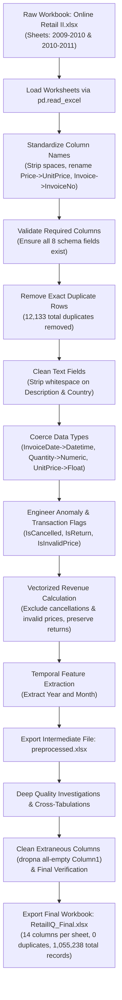

# RetailIQ – Python, Power BI & Data Science

An end-to-end retail business intelligence and data science project analyzing multi-year transactional retail data using **Python**, **Power BI**, and **Advanced Analytics**.

---

## Table of Contents
- [1. Project Overview](#1-project-overview)
- [2. Project Objectives](#2-project-objectives)
- [3. Dataset Overview & Source](#3-dataset-overview--source)
- [4. Technology Stack](#4-technology-stack)
- [5. Project Directory Structure](#5-project-directory-structure)
- [6. Data Preprocessing Workflow](#6-data-preprocessing-workflow)
- [7. Implementation vs. Investigations vs. Decisions](#7-implementation-vs-investigations-vs-decisions)
- [8. Data Quality Findings & Validation Results](#8-data-quality-findings--validation-results)
- [9. Final Dataset Statistics](#9-final-dataset-statistics)
- [10. Current Project Status](#10-current-project-status)
- [11. Upcoming Stages](#11-upcoming-stages)

---

## 1. Project Overview

**RetailIQ** is an enterprise-grade analytics project designed to turn raw transactional e-commerce data into actionable business intelligence. The dataset encompasses international transactions from a UK-based online retail business across two consecutive operational years (2009–2010 and 2010–2011).

The current phase focuses on rigorous, verifiable data preprocessing, feature engineering, and data quality auditing using Python, preparing clean, validated data foundations for subsequent exploratory data analysis (EDA), statistical modeling, and interactive Power BI dashboard development.

---

## 2. Project Objectives

- **Data Integrity & Normalization**: Standardize inconsistent schemas across multi-year sheets, eliminate duplicate records, format data types, and normalize textual fields.
- **Transaction & Anomaly Classification**: Accurately detect and flag order cancellations, product returns, zero-price items, and accounting balance adjustments without destroying audit trails.
- **Accurate Financial Modeling**: Establish robust business rules for revenue calculation that correctly account for refunds and cancellations while isolating invalid transactions.
- **Enterprise-Grade Documentation**: Provide reproducible preprocessing pipelines, transparent audit metrics, and clear tracking of data-cleaning rationales.
- **Downstream BI & Analytics Readiness**: Output clean, validated data structures optimized for exploratory data analysis (EDA), customer segmentation (RFM), cohort retention modeling, and interactive Power BI executive dashboards.

---

## 3. Dataset Overview & Source

The dataset used in this project is the widely recognized **Online Retail II** dataset, sourced from the **UCI Machine Learning Repository**:
- **Source**: [UCI Machine Learning Repository: Online Retail II](https://archive.ics.uci.edu/dataset/502/online+retail+ii)
- **Timeframe**: 01/12/2009 to 09/12/2011 (2 distinct annual operational cycles).
- **Domain**: E-commerce / Giftware & Wholesaler transactions based in the United Kingdom, serving both domestic and international wholesale/retail clients.
- **Storage Format**: Excel Workbook (`.xlsx`) containing two yearly worksheets:
  - `Year 2009-2010`: Transactions from December 1, 2009 to December 9, 2010.
  - `Year 2010-2011`: Transactions from December 1, 2010 to December 9, 2011.

### Raw Data Schema:
| Column | Raw Type | Description |
|---|---|---|
| `Invoice` | Object / String | 6-digit invoice number. If the code starts with 'C', it indicates a cancellation. |
| `StockCode` | Object / String | 5-digit product code, occasionally followed by letter suffixes or operational codes. |
| `Description` | Object / String | Product/item name. |
| `Quantity` | Integer | Quantities of each product per transaction. |
| `InvoiceDate` | Datetime / Object | The day and time when each transaction was generated. |
| `Price` | Float | Product unit price in sterling (£). |
| `Customer ID` | Float / Object | 5-digit customer number identifier. |
| `Country` | Object / String | Country of client residence. |
| `Column1` | Object (Sheet 2 only)| Extraneous, entirely empty column present in the raw 2010–2011 worksheet. |

---

## 4. Technology Stack

- **Data Processing & Scripting**: Python 3.10+, Jupyter Notebook (`preprocessing.ipynb`)
- **Core Libraries**:
  - `pandas`: Vectorized manipulation, data cleaning, datetime parsing, cross-tabulation.
  - `numpy`: Conditional vectorized logic (`np.where`).
  - `openpyxl`: Excel reading and multi-sheet writing engine.
- **Version Control & Repository Management**: Git, GitHub
- **Planned BI & Visualization**: Power BI Desktop (DAX, Power Query, Data Modeling), Python (`matplotlib`, `seaborn`)

---

## 5. Project Directory Structure

```text
retailiq-python-powerbi-datascience/
│
├── .gitignore               # Ignored build artifacts, checkpoints, and OS/Excel lock files
├── README.md                # Comprehensive project documentation (this file)
├── preprocessing.ipynb      # Complete, reproducible Python preprocessing notebook
│
├── Online Retail II.xlsx    # Original raw multi-sheet Excel dataset (UCI Repository)
├── preprocessed.xlsx        # Intermediate preprocessing output (flagged, standardized)
└── RetailIQ_Final.xlsx      # Final validated production dataset (cleaned, verified schema)
```

---

## 6. Data Preprocessing Workflow

The preprocessing pipeline implemented in `preprocessing.ipynb` follows a modular and strictly validated approach across both annual worksheets:



### Detailed Pipeline Steps:
1. **Multi-Sheet Ingestion**: Both `Year 2009-2010` and `Year 2010-2011` are ingested dynamically via `pd.read_excel(file_path, sheet_name=None)`.
2. **Column Normalization**:
   - Stripped leading/trailing spaces and internal spaces: `df.columns = df.columns.astype(str).str.strip().str.replace(" ", "", regex=False)`.
   - Renamed `Customer ID` to `CustomerID`, `Invoice` to `InvoiceNo`, and `Price` to `UnitPrice`.
   - Validated schema compliance against required column specifications.
3. **Deduplication**: Executed `df.drop_duplicates(inplace=True)` on each sheet.
4. **Text Sanitization**: Coerced `Description` and `Country` to nullable strings and stripped excess padding.
5. **Type Coercion**:
   - `InvoiceDate` converted to `datetime64[ns]` with error coercion.
   - `Quantity` converted to numeric integer format.
   - `UnitPrice` converted to 64-bit floating point.
6. **Transaction & Anomaly Flagging**:
   - `IsCancelled`: Boolean flag identifying order cancellations where `InvoiceNo.str.startswith("C")`.
   - `IsReturn`: Boolean flag identifying negative volume where `Quantity < 0`.
   - `IsInvalidPrice`: Boolean flag identifying zero or negative unit costs where `UnitPrice <= 0`.
7. **Vectorized Revenue Computation**:
   Implemented conditional business logic:
   $$\text{Revenue} = \begin{cases} \text{Quantity} \times \text{UnitPrice} & \text{if } \neg\text{IsCancelled} \wedge \text{UnitPrice} > 0 \wedge \text{Quantity is not null} \\ 0 & \text{otherwise} \end{cases}$$
   *Note: For legitimate non-cancelled customer returns ($\text{Quantity} < 0$), revenue computes as negative, accurately recording refund debits.*
8. **Date Part Extraction**: Computed `Year` and `Month` directly from `InvoiceDate`.
9. **Schema Finalization**:
   - Dropped entirely empty columns (`df.dropna(axis=1, how="all")`), cleanly eliminating the raw artifact `Column1` from `Year 2010-2011`.
   - Exported both processed sheets into `RetailIQ_Final.xlsx`.

---

## 7. Implementation vs. Investigations vs. Decisions

To maintain analytical rigor, the project separates programmatic execution from exploratory audits and business retention rules:

### A. Operations Implemented in Code
- Automated column renaming and space stripping.
- Systematic full-row deduplication across both sheets.
- Text trimming on `Description` and `Country`.
- Type casting (`datetime64[ns]`, `float64`, `int64`, `boolean`).
- Algorithmic generation of `IsCancelled`, `IsReturn`, `IsInvalidPrice`, `Revenue`, `Year`, and `Month`.
- Automated dropping of entirely null columns (`Column1`).
- Multi-sheet Excel workbook export (`preprocessed.xlsx` and `RetailIQ_Final.xlsx`).

### B. Data-Quality Investigations Performed
- **StockCode Distribution**: Evaluated numeric codes vs. alphanumeric suffixes (e.g., `85123A`, `POST`, `D` [Discount], `M` [Manual], `S` [Samples], `B` [Bad Debt]).
- **Zero-Price Root Cause Analysis**: Discovered that zero-price lines represent inventory write-offs, damaged stock, unexplainable losses, warehouse checks, and promotional samples.
- **Negative-Price Analysis**: Identified exactly 5 records across both years with negative unit prices, all tied to `StockCode: B` with description `"Adjust bad debt"`.
- **Cancellation vs. Return Overlap**: Discovered that while most negative quantities are flagged with an invoice `'C'` prefix, thousands of return transactions (`2,121` in 09–10; `1,336` in 10–11) have standard invoice numbers.
- **CustomerID vs. UnitPrice Crosstab**: Verified that ~98% of zero-price records lack a `CustomerID`, but a small subset (31 in 09–10; 40 in 10–11) belong to registered customer accounts.

### C. Strategic Cleaning Decisions & Rationale
Contrary to naive data-cleaning practices that delete any row containing missing or negative values, **records were deliberately retained** based on explicit business logic:

1. **Retaining Missing `CustomerID` (107,833 in 09–10; 135,037 in 10–11)**:
   - *Rationale*: These rows represent guest checkouts and anonymous online shoppers. Deleting them would artificially erase over £3.6M+ in legitimate sales revenue and severely skew market basket analysis. They are retained for sales, revenue, and product analytics, but will be isolated during customer-level (RFM) modeling.
2. **Retaining Missing `Description` (2,928 in 09–10; 1,454 in 10–11)**:
   - *Rationale*: All missing descriptions coincide with zero-price administrative adjustments and missing customer IDs. Retaining them preserves the raw transaction count for operational auditing.
3. **Retaining Zero-Price Transactions (`UnitPrice == 0`) (3,681 in 09–10; 2,510 in 10–11)**:
   - *Rationale*: Zero-price rows represent operational events (damages, inventory lost, samples). They are flagged via `IsInvalidPrice` and assigned `0` revenue to prevent financial distortion while retaining data for supply chain/loss auditing.
4. **Retaining Negative Quantities (`Quantity < 0`) (12,302 in 09–10; 10,587 in 10–11)**:
   - *Rationale*: Negative quantities represent genuine product returns and reverse logistics. Retaining them allows for the calculation of return rates, return volumes, and net revenue.
5. **Retaining Negative-Price Bad Debt Records (`UnitPrice < 0`) (3 in 09–10; 2 in 10–11)**:
   - *Rationale*: Invoices starting with `A` (e.g., `A506401`, `A563186`) denote corporate bad debt accounting adjustments (e.g., -£53,594.36). Assigned `0` revenue via our business rule to avoid corrupting top-line commercial turnover while retaining ledger traceability.

> [!NOTE]
> **Dataset Cleanliness Notice**: The final dataset is **not** completely free of missing values or negative entries. It is a structured, flagged, and audited representation that preserves business realities while preventing calculation errors.

---

## 8. Data Quality Findings & Validation Results

### Metric Verification Summary

| Metric / Audit Parameter | Year 2009–2010 | Year 2010–2011 | Combined Total |
|---|---:|---:|---:|
| **Initial Raw Records** | 525,461 | 541,910 | 1,067,371 |
| **Duplicate Records Removed** | 6,865 | 5,268 | 12,133 |
| **Final Preprocessed Records** | **518,596** | **536,642** | **1,055,238** |
| **Total Columns** | 14 | 14 | 14 |
| **Duplicate Records in Final File** | **0** | **0** | **0** |
| **Missing CustomerID** | 107,833 | 135,037 | 242,870 |
| **Missing Description** | 2,928 | 1,454 | 4,382 |
| **Zero UnitPrice (`UnitPrice == 0`)** | 3,681 | 2,510 | 6,191 |
| **Negative UnitPrice (`UnitPrice < 0`)** | 3 | 2 | 5 |
| **Total Invalid Prices (`IsInvalidPrice`)** | 3,684 | 2,512 | 6,196 |
| **Negative Quantity (`Quantity < 0`)** | 12,302 | 10,587 | 22,889 |
| **Cancelled Invoices (`IsCancelled`)** | 10,182 | 9,251 | 19,433 |
| **Total Calculated Revenue (£)** | **10,271,762.664** | **10,642,128.804** | **20,913,891.468** |

*Financial Reconciliation Note: Exact sum of validated worksheet revenues: £10,271,762.664 + £10,642,128.804 = **£20,913,891.468**.*

### Revenue Validation Check
An automated audit was executed in `preprocessing.ipynb` comparing the stored `Revenue` column against an independently computed formula:
$$\Delta = |\text{Revenue}_{\text{actual}} - \text{Revenue}_{\text{expected}}|$$
- **Revenue Mismatches (> 0.001)**: **0** across all 1,055,238 rows.
- **Cancelled Invoices Revenue**: Exactly **£0.00**.
- **Negative Price Adjustments Revenue**: Exactly **£0.00**.

---

## 9. Final Dataset Statistics

The production dataset is stored in `RetailIQ_Final.xlsx` across two sheets:
- **Sheet 1**: `Year 2009-2010` (518,596 rows, 14 columns)
- **Sheet 2**: `Year 2010-2011` (536,642 rows, 14 columns)

### Final Schema (14 Columns):
1. `InvoiceNo` (*string/object*): Unique identifier for each order (6 digits, or 'C'/'A' prefix).
2. `StockCode` (*string/object*): Unique identifier for each distinct product or service.
3. `Description` (*string*): Cleaned item name.
4. `Quantity` (*integer*): Units sold or returned.
5. `InvoiceDate` (*datetime64*): Timestamp of transaction.
6. `UnitPrice` (*float64*): Unit price per product in GBP (£).
7. `CustomerID` (*float64*): Unique client identifier.
8. `Country` (*string*): Destination/residence country.
9. `IsCancelled` (*boolean*): `True` if `InvoiceNo` begins with `'C'`.
10. `IsReturn` (*boolean*): `True` if `Quantity < 0`.
11. `IsInvalidPrice` (*boolean*): `True` if `UnitPrice <= 0`.
12. `Revenue` (*float64*): Validated financial revenue contribution in GBP (£).
13. `Year` (*integer*): Extracted calendar year.
14. `Month` (*integer*): Extracted calendar month (1–12).

---

## 10. Current Project Status

- [x] Comprehensive review of raw retail transaction data.
- [x] Schema harmonization across multi-year sheets.
- [x] Full deduplication (12,133 duplicate records removed).
- [x] Anomaly identification and categorical flagging (`IsCancelled`, `IsReturn`, `IsInvalidPrice`).
- [x] Financial revenue engineering and zero-mismatch validation.
- [x] Intermediate (`preprocessed.xlsx`) and production (`RetailIQ_Final.xlsx`) file generation.
- [x] Complete project documentation and GitHub repository publication.

---

## 11. Upcoming Stages

1. **Stage 2: Exploratory Data Analysis (EDA) & Diagnostics (Python)**
   - Monthly and quarterly revenue trends, seasonality decomposition, and holiday surges.
   - Geographic distribution analysis (UK domestic sales vs. international wholesale).
   - Cancellation and return root-cause analysis by product category and region.
   - Pareto analysis (80/20 rule) on top revenue-generating SKUs.
2. **Stage 3: Advanced Customer Analytics & Machine Learning**
   - **RFM Analysis (Recency, Frequency, Monetary)**: Segmenting registered customers into Champions, Loyal Customers, At Risk, and Lost.
   - **Cohort Retention Modeling**: Tracking customer repurchase behaviors over time.
   - **Market Basket Analysis**: Association rule mining (Apriori / FP-Growth) to discover cross-selling opportunities.
3. **Stage 4: Power BI Enterprise Dashboard Development**
   - Star schema data modeling (Fact Sales, Dim Date, Dim Customer, Dim Product, Dim Geography).
   - Advanced DAX metrics: Year-over-Year (YoY) growth, Month-over-Month (MoM) sales velocity, Customer Lifetime Value (CLV), Return Rate %.
   - Interactive executive reporting: Executive Summary, Customer Deep Dive, Product Performance, and Operational Anomaly Tracker.

---

## Author & Acknowledgements
- **Author**: Parth Garg
- **Repository**: [retailiq-python-powerbi-datascience](https://github.com/parthgarg0/retailiq-python-powerbi-datascience)
- **Dataset**: Provided by UCI Machine Learning Repository (Online Retail II dataset contributed by Daqing Chen, Sai Liang Sain, and Kun Guo).
