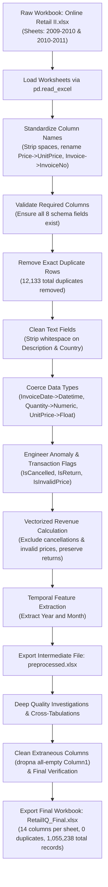
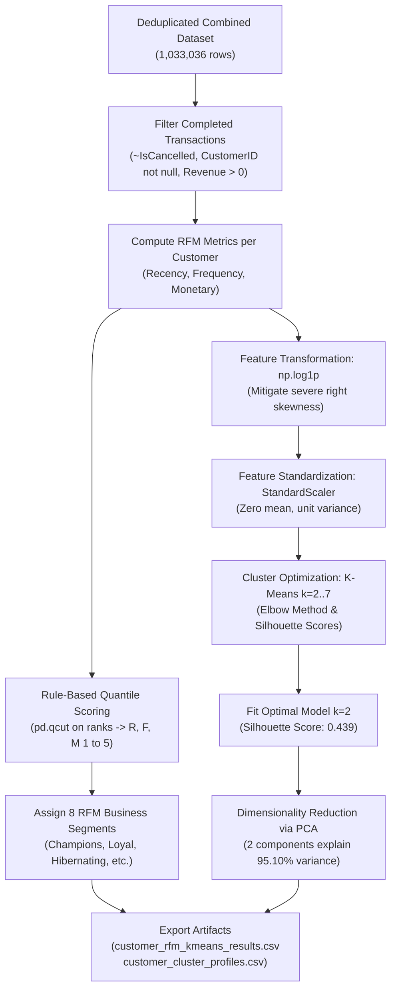

# RetailIQ – Python, Power BI & Data Science

An end-to-end retail business intelligence and data science project analyzing multi-year transactional retail data using **Python**, **Power BI**, and **Advanced Analytics**.

---

## Table of Contents
- [1. Project Overview](#1-project-overview)
- [2. Project Objectives](#2-project-objectives)
- [3. Dataset Overview & Source](#3-dataset-overview--source)
- [4. Technology Stack](#4-technology-stack)
- [5. Project Directory Structure](#5-project-directory-structure)
- [6. Project Workflow](#6-project-workflow)
- [7. Data Preprocessing Workflow](#7-data-preprocessing-workflow)
- [8. Implementation vs. Investigations vs. Decisions](#8-implementation-vs-investigations-vs-decisions)
- [9. Data Quality Findings & Validation Results](#9-data-quality-findings--validation-results)
- [10. Final Dataset Statistics](#10-final-dataset-statistics)
- [11. Exploratory Data Analysis (EDA)](#11-exploratory-data-analysis-eda)
  - [11.1 EDA Overview & Objectives](#111-eda-overview--objectives)
  - [11.2 Cross-Sheet Deduplication & Dataset Dimensions](#112-cross-sheet-deduplication--dataset-dimensions)
  - [11.3 Summary of Eight Core EDA Tasks](#113-summary-of-eight-core-eda-tasks)
  - [11.4 Key Analytical Findings & Business Insights](#114-key-analytical-findings--business-insights)
  - [11.5 Customer RFM Segmentation Analysis](#115-customer-rfm-segmentation-analysis)
  - [11.6 Product Performance, Growth & Decline](#116-product-performance-growth--decline)
  - [11.7 Geographic Performance & Wholesale Dynamics](#117-geographic-performance--wholesale-dynamics)
  - [11.8 Temporal Trends & Trading Velocity](#118-temporal-trends--trading-velocity)
  - [11.9 Cancellations, Returns & Anomaly Diagnostics](#119-cancellations-returns--anomaly-diagnostics)
  - [11.10 Revenue Validation Methodology](#1110-revenue-validation-methodology)
  - [11.11 Analytical Limitations & Interpretation Cautions](#1111-analytical-limitations--interpretation-cautions)
  - [11.12 Link to EDA Notebook](#1112-link-to-eda-notebook)
- [12. Machine Learning](#12-machine-learning)
  - [12.1 Customer Analysis & Segmentation — RFM + K-Means](#121-customer-analysis--segmentation--rfm--k-means)
  - [12.2 Sales Forecasting — ARIMA, SARIMA & Baselines](#122-sales-forecasting--arima-sarima--baselines)
- [13. Business Insights & Practical Recommendations](#13-business-insights--practical-recommendations)
- [14. Future Scope](#14-future-scope)
- [Author & Acknowledgements](#author--acknowledgements)

---

## 1. Project Overview

**RetailIQ** is an enterprise-grade analytics project designed to turn raw transactional e-commerce data into actionable business intelligence. The dataset encompasses international transactions from a UK-based online retail business across two consecutive operational years (2009–2010 and 2010–2011).

The project combines rigorous, verifiable data preprocessing, feature engineering, exploratory data analysis (EDA), customer segmentation (RFM + K-Means), and monthly time-series sales forecasting (ARIMA / SARIMA / Seasonal Naive) using Python, establishing a production-grade analytics foundation for interactive Power BI executive dashboards.

---

## 2. Project Objectives

- **Data Integrity & Normalization**: Standardize inconsistent schemas across multi-year sheets, eliminate duplicate records, format data types, and normalize textual fields.
- **Transaction & Anomaly Classification**: Accurately detect and flag order cancellations, product returns, zero-price items, and accounting balance adjustments without destroying audit trails.
- **Accurate Financial Modeling**: Establish robust business rules for revenue calculation that correctly account for refunds and cancellations while isolating invalid transactions.
- **Comprehensive Exploratory Data Analysis**: Evaluate multi-year sales velocity, seasonality surges, customer retention behaviors, product performance lifecycles, and geographic expansion patterns.
- **Customer Intelligence via Machine Learning**: Group customers using RFM metrics and unsupervised K-Means clustering to distinguish core loyal buyers from dormant accounts.
- **Predictive Time-Series Forecasting**: Build, evaluate, and benchmark revenue forecasting models (ARIMA, SARIMA, Naive, Seasonal Naive) using rolling-origin cross-validation.
- **Enterprise-Grade Documentation**: Provide reproducible preprocessing pipelines, transparent audit metrics, and clear tracking of data-cleaning rationales.
- **Downstream BI & Analytics Readiness**: Output clean, validated data structures optimized for interactive Power BI executive dashboards.

---

## 3. Dataset Overview & Source

The dataset used in this project is the widely recognized **Online Retail II** dataset, sourced from the **UCI Machine Learning Repository**:
- **Source**: [UCI Machine Learning Repository: Online Retail II](https://archive.ics.uci.edu/dataset/502/online+retail+ii)
- **Timeframe**: 01/12/2009 to 09/12/2011 (2 distinct annual operational cycles).
- **Domain**: E-commerce / Giftware & Wholesaler transactions based in the United Kingdom, serving both domestic and international wholesale/retail clients.
- **Storage Format**: Excel Workbook (`.xlsx`) containing two yearly worksheets:
  - `Year 2009-2010`: Transactions from December 1, 2009 to December 9, 2010.
  - `Year 2010-2011`: Transactions from December 1, 2010 to December 9, 2011.

### Raw Data Schema:
| Column | Raw Type | Description |
|---|---|---|
| `Invoice` | Object / String | 6-digit invoice number. If the code starts with 'C', it indicates a cancellation. |
| `StockCode` | Object / String | 5-digit product code, occasionally followed by letter suffixes or operational codes. |
| `Description` | Object / String | Product/item name. |
| `Quantity` | Integer | Quantities of each product per transaction. |
| `InvoiceDate` | Datetime / Object | The day and time when each transaction was generated. |
| `Price` | Float | Product unit price in sterling (£). |
| `Customer ID` | Float / Object | 5-digit customer number identifier. |
| `Country` | Object / String | Country of client residence. |
| `Column1` | Object (Sheet 2 only)| Extraneous, entirely empty column present in the raw 2010–2011 worksheet. |

---

## 4. Technology Stack

- **Data Processing & Scripting**: Python 3.10+, Jupyter Notebooks
- **Core Libraries**:
  - `pandas`: Vectorized manipulation, data cleaning, datetime parsing, cross-tabulation, aggregation.
  - `numpy`: Conditional vectorized logic (`np.where`, `np.isclose`), mathematical transformations (`np.log1p`).
  - `scikit-learn`: Feature scaling (`StandardScaler`), clustering (`KMeans`), cluster validation (`silhouette_score`), dimensionality reduction (`PCA`), model metrics (`mean_absolute_error`, `mean_squared_error`, `r2_score`).
  - `statsmodels`: Time-series forecasting (`ARIMA`, `SARIMAX`).
  - `matplotlib` & `seaborn`: Data visualization, cluster scatter plots, trend lines, diagnostic plots.
  - `openpyxl`: Excel reading and multi-sheet writing engine.
- **Version Control & Repository Management**: Git, GitHub
- **Planned BI & Visualization**: Power BI Desktop (DAX, Power Query, Star Schema Data Modeling)

---

## 5. Project Directory Structure

```text
RetailIQ/
│
├── preprocessing/
│   └── preprocessing.ipynb
│
├── eda/
│   └── eda.ipynb
│
├── machine_learning/
│   ├── 01_customer_analysis_rfm_kmeans.ipynb
│   ├── 02_sales_forecasting.ipynb
│   ├── customer_rfm_kmeans_results.csv
│   ├── customer_cluster_profiles.csv
│   ├── forecasting_model_evaluation.csv
│   ├── rolling_forecast_predictions.csv
│   └── future_sales_forecast.csv
│
├── power_bi/
│   └── (dashboard will be added later)
│
├── Online Retail II.xlsx
├── preprocessed.xlsx
├── RetailIQ_Final.xlsx
├── README.md
└── .gitignore
```

---

## 6. Project Workflow

The project is structured into six progressive phases:

1. **Stage 1: Data Collection & Ingestion** — `[Completed]`  
   Acquired the multi-year raw transaction logs from the UCI Machine Learning Repository (`Online Retail II.xlsx`).
2. **Stage 2: Data Cleaning & Preprocessing** — `[Completed]`  
   Standardized column schemas, removed 12,133 single-sheet duplicates, engineered business anomaly flags, applied validated revenue rules, and produced `preprocessed.xlsx` and `RetailIQ_Final.xlsx` ([preprocessing.ipynb](preprocessing/preprocessing.ipynb)).
3. **Stage 3: Exploratory Data Analysis (EDA)** — `[Completed]`  
   Identified and resolved 22,202 cross-sheet duplicates, audited sales velocity, seasonal surges, product lifecycles, international wholesale dynamics, and validated calculation precision ([eda.ipynb](eda/eda.ipynb)).
4. **Stage 4: Customer Analysis & Segmentation** — `[Completed]`  
   Engineered RFM metrics, log-transformed/scaled features, ran K-Means clustering ($k=2$, Silhouette Score: 0.439), visualized clusters via PCA, and profiled behavioral segments ([01_customer_analysis_rfm_kmeans.ipynb](machine_learning/01_customer_analysis_rfm_kmeans.ipynb)).
5. **Stage 5: Sales Forecasting & Model Evaluation** — `[Completed]`  
   Prepared monthly time series, implemented rolling-origin cross-validation over a 6-month test horizon, evaluated Naive, Seasonal Naive, ARIMA, and SARIMA models, and forecasted 3 months into the future ([02_sales_forecasting.ipynb](machine_learning/02_sales_forecasting.ipynb)).
6. **Stage 6: Interactive Power BI Dashboard** — `[Upcoming]`  
   Architecting a dimensional star schema, building executive DAX measures, and designing interactive dashboards in Power BI Desktop.

---

## 7. Data Preprocessing Workflow

The preprocessing pipeline implemented in [preprocessing/preprocessing.ipynb](preprocessing/preprocessing.ipynb) follows a modular and strictly validated approach across both annual worksheets:



### Detailed Pipeline Steps:
1. **Multi-Sheet Ingestion**: Both `Year 2009-2010` and `Year 2010-2011` are ingested dynamically via `pd.read_excel(file_path, sheet_name=None)`.
2. **Column Normalization**:
   - Stripped leading/trailing spaces and internal spaces: `df.columns = df.columns.astype(str).str.strip().str.replace(" ", "", regex=False)`.
   - Renamed `Customer ID` to `CustomerID`, `Invoice` to `InvoiceNo`, and `Price` to `UnitPrice`.
   - Validated schema compliance against required column specifications.
3. **Deduplication**: Executed `df.drop_duplicates(inplace=True)` on each sheet.
4. **Text Sanitization**: Coerced `Description` and `Country` to nullable strings and stripped excess padding.
5. **Type Coercion**:
   - `InvoiceDate` converted to `datetime64[ns]` with error coercion.
   - `Quantity` converted to numeric integer format.
   - `UnitPrice` converted to 64-bit floating point.
6. **Transaction & Anomaly Flagging**:
   - `IsCancelled`: Boolean flag identifying order cancellations where `InvoiceNo.str.startswith("C")`.
   - `IsReturn`: Boolean flag identifying negative volume where `Quantity < 0`.
   - `IsInvalidPrice`: Boolean flag identifying zero or negative unit costs where `UnitPrice <= 0`.
7. **Vectorized Revenue Computation**:
   Implemented conditional business logic:
   $$\text{Revenue} = \begin{cases} \text{Quantity} \times \text{UnitPrice} & \text{if } \neg\text{IsCancelled} \wedge \text{UnitPrice} > 0 \wedge \text{Quantity is not null} \\ 0 & \text{otherwise} \end{cases}$$
   *Note: For legitimate non-cancelled customer returns ($\text{Quantity} < 0$), revenue computes as negative, accurately recording refund debits.*
8. **Date Part Extraction**: Computed `Year` and `Month` directly from `InvoiceDate`.
9. **Schema Finalization**:
   - Dropped entirely empty columns (`df.dropna(axis=1, how="all")`), cleanly eliminating the raw artifact `Column1` from `Year 2010-2011`.
   - Exported both processed sheets into `RetailIQ_Final.xlsx`.

---

## 8. Implementation vs. Investigations vs. Decisions

To maintain analytical rigor, the project separates programmatic execution from exploratory audits and business retention rules:

### A. Operations Implemented in Code
- Automated column renaming and space stripping.
- Systematic full-row deduplication across both sheets.
- Text trimming on `Description` and `Country`.
- Type casting (`datetime64[ns]`, `float64`, `int64`, `boolean`).
- Algorithmic generation of `IsCancelled`, `IsReturn`, `IsInvalidPrice`, `Revenue`, `Year`, and `Month`.
- Automated dropping of entirely null columns (`Column1`).
- Multi-sheet Excel workbook export (`preprocessed.xlsx` and `RetailIQ_Final.xlsx`).

### B. Data-Quality Investigations Performed
- **StockCode Distribution**: Evaluated numeric codes vs. alphanumeric suffixes (e.g., `85123A`, `POST`, `D` [Discount], `M` [Manual], `S` [Samples], `B` [Bad Debt]).
- **Zero-Price Root Cause Analysis**: Discovered that zero-price lines represent inventory write-offs, damaged stock, unexplainable losses, warehouse checks, and promotional samples.
- **Negative-Price Analysis**: Identified exactly 5 records across both years with negative unit prices, all tied to `StockCode: B` with description `"Adjust bad debt"`.
- **Cancellation vs. Return Overlap**: Discovered that while most negative quantities are flagged with an invoice `'C'` prefix, thousands of return transactions (`2,121` in 09–10; `1,336` in 10–11) have standard invoice numbers.
- **CustomerID vs. UnitPrice Crosstab**: Verified that ~98% of zero-price records lack a `CustomerID`, but a small subset (31 in 09–10; 40 in 10–11) belong to registered customer accounts.

### C. Strategic Cleaning Decisions & Rationale
Contrary to naive data-cleaning practices that delete any row containing missing or negative values, **records were deliberately retained** based on explicit business logic:

1. **Retaining Missing `CustomerID` (107,833 in 09–10; 135,037 in 10–11)**:
   - *Rationale*: These rows represent guest checkouts and anonymous online shoppers. Deleting them would artificially erase over £3.6M+ in legitimate sales revenue and severely skew market basket analysis. They are retained for sales, revenue, and product analytics, but isolated during customer-level modeling.
2. **Retaining Missing `Description` (2,928 in 09–10; 1,454 in 10–11)**:
   - *Rationale*: All missing descriptions coincide with zero-price administrative adjustments and missing customer IDs. Retaining them preserves the raw transaction count for operational auditing.
3. **Retaining Zero-Price Transactions (`UnitPrice == 0`) (3,681 in 09–10; 2,510 in 10–11)**:
   - *Rationale*: Zero-price rows represent operational events (damages, inventory lost, samples). They are flagged via `IsInvalidPrice` and assigned `0` revenue to prevent financial distortion while retaining data for supply chain/loss auditing.
4. **Retaining Negative Quantities (`Quantity < 0`) (12,302 in 09–10; 10,587 in 10–11)**:
   - *Rationale*: Negative quantities represent genuine product returns and reverse logistics. Retaining them allows for the calculation of return rates, return volumes, and net revenue.
5. **Retaining Negative-Price Bad Debt Records (`UnitPrice < 0`) (3 in 09–10; 2 in 10–11)**:
   - *Rationale*: Invoices starting with `A` (e.g., `A506401`, `A563186`) denote corporate bad debt accounting adjustments (e.g., -£53,594.36). Assigned `0` revenue via our business rule to avoid corrupting top-line commercial turnover while retaining ledger traceability.

> [!NOTE]
> **Dataset Cleanliness Notice**: The final dataset is **not** completely free of missing values or negative entries. It is a structured, flagged, and audited representation that preserves business realities while preventing calculation errors.

---

## 9. Data Quality Findings & Validation Results

### Metric Verification Summary

| Metric / Audit Parameter | Year 2009–2010 | Year 2010–2011 | Combined Total |
|---|---:|---:|---:|
| **Initial Raw Records** | 525,461 | 541,910 | 1,067,371 |
| **Duplicate Records Removed** | 6,865 | 5,268 | 12,133 |
| **Final Preprocessed Records** | **518,596** | **536,642** | **1,055,238** |
| **Total Columns** | 14 | 14 | 14 |
| **Duplicate Records in Final File** | **0** | **0** | **0** |
| **Missing CustomerID** | 107,833 | 135,037 | 242,870 |
| **Missing Description** | 2,928 | 1,454 | 4,382 |
| **Zero UnitPrice (`UnitPrice == 0`)** | 3,681 | 2,510 | 6,191 |
| **Negative UnitPrice (`UnitPrice < 0`)** | 3 | 2 | 5 |
| **Total Invalid Prices (`IsInvalidPrice`)** | 3,684 | 2,512 | 6,196 |
| **Negative Quantity (`Quantity < 0`)** | 12,302 | 10,587 | 22,889 |
| **Cancelled Invoices (`IsCancelled`)** | 10,182 | 9,251 | 19,433 |
| **Total Calculated Revenue (£)** | **10,271,762.664** | **10,642,128.804** | **20,913,891.468** |

*Financial Reconciliation Note: Exact sum of validated worksheet revenues: £10,271,762.664 + £10,642,128.804 = **£20,913,891.468**.*

### Revenue Validation Check
An automated audit was executed in `preprocessing.ipynb` comparing the stored `Revenue` column against an independently computed formula:
$$\Delta = |\text{Revenue}_{\text{actual}} - \text{Revenue}_{\text{expected}}|$$
- **Revenue Mismatches (> 0.001)**: **0** across all 1,055,238 rows.
- **Cancelled Invoices Revenue**: Exactly **£0.00**.
- **Negative Price Adjustments Revenue**: Exactly **£0.00**.

---

## 10. Final Dataset Statistics

The production dataset is stored in `RetailIQ_Final.xlsx` across two sheets:
- **Sheet 1**: `Year 2009-2010` (518,596 rows, 14 columns)
- **Sheet 2**: `Year 2010-2011` (536,642 rows, 14 columns)

### Final Schema (14 Columns):
1. `InvoiceNo` (*string/object*): Unique identifier for each order (6 digits, or 'C'/'A' prefix).
2. `StockCode` (*string/object*): Unique identifier for each distinct product or service.
3. `Description` (*string*): Cleaned item name.
4. `Quantity` (*integer*): Units sold or returned.
5. `InvoiceDate` (*datetime64*): Timestamp of transaction.
6. `UnitPrice` (*float64*): Unit price per product in GBP (£).
7. `CustomerID` (*float64*): Unique client identifier.
8. `Country` (*string*): Destination/residence country.
9. `IsCancelled` (*boolean*): `True` if `InvoiceNo` begins with `'C'`.
10. `IsReturn` (*boolean*): `True` if `Quantity < 0`.
11. `IsInvalidPrice` (*boolean*): `True` if `UnitPrice <= 0`.
12. `Revenue` (*float64*): Validated financial revenue contribution in GBP (£).
13. `Year` (*integer*): Extracted calendar year.
14. `Month` (*integer*): Extracted calendar month (1–12).

---

## 11. Exploratory Data Analysis (EDA)

### 11.1 EDA Overview & Objectives
The Exploratory Data Analysis phase, executed in [eda/eda.ipynb](eda/eda.ipynb), investigates the multi-year transactional dynamics of the business across the two operational periods (2009–2010 and 2010–2011).

The core objectives of the EDA were:
1. Assess multi-year revenue trends, order velocity, and average order value (AOV) dynamics.
2. Uncover customer engagement patterns and perform behavioral segmentation using Recency, Frequency, and Monetary (RFM) modeling.
3. Quantify product sales concentration, identify top revenue contributors, and diagnose high-growth vs. declining SKUs.
4. Map international revenue distribution and contrast domestic retail versus international wholesale order profiles.
5. Identify recurring temporal purchase behaviors across seasonal months, days of the week, and hours of the day.
6. Scrutinize cancellation rates, return volumes, and operational adjustments to prevent analytical misinterpretation.
7. Conduct deep stress-testing of numerical distributions, extreme transactions, and floating-point revenue calculations.

---

### 11.2 Cross-Sheet Deduplication & Dataset Dimensions

A critical structural discovery made during the EDA was the presence of **cross-sheet duplicate records** between the two yearly files. 

While each sheet was individually deduplicated during initial preprocessing, the two annual periods shared an overlapping reporting window between **December 1, 2010 and December 9, 2010**:
- **Overlapping Invoice Numbers**: **1,088** unique invoice IDs appeared in both sheets.
- **Identical Records in Year 2009–2010**: **22,202** rows.
- **Identical Records in Year 2010–2011**: **22,202** rows.
- **Exact Inner-Merge Duplication**: Exactly **22,202** records were identical across all 14 columns.

```python
# Cross-sheet deduplication implementation (eda/eda.ipynb, Cell 4)
df_combined = pd.concat([df1, df2], ignore_index=True)
df_combined = df_combined.drop_duplicates().reset_index(drop=True)
```

#### Final Dimensions & Volume Reconciliation:
- **Naive Combined Rows**: $518,596 + 536,642 = 1,055,238$ rows (Revenue: £20,913,891.47)
- **Cross-Sheet Duplicates Removed**: **22,202** rows
- **Corrected Combined Records**: **1,033,036** rows
- **Remaining Duplicate Records**: **0**
- **Corrected Combined Revenue**: **£20,476,260.45**
- **Corrected Non-Cancelled Orders**: **45,336**
- **Corrected Net Quantity Sold**: **10,409,779** units
- **Corrected Average Order Value (AOV)**: **£451.66**

---

### 11.3 Summary of Eight Core EDA Tasks

The exploration in [eda/eda.ipynb](eda/eda.ipynb) systematically addressed eight key analytical domains:

1. **Dataset Overview**: Evaluated total dimensions, date ranges (2009-12-01 to 2011-12-09), unique invoice counts (53,628), unique product SKUs (5,305), unique customer profiles (5,942), and international markets (43 countries).
2. **Sales Performance Analysis**: Evaluated annual revenue, non-cancelled order volume, net quantity, and Average Order Value (AOV), tracking a 3.61% revenue increase between periods.
3. **Customer Analysis & Recalculated RFM**: Evaluated customer concentration, order frequency, and engineered an RFM segmentation model across 5,881 active accounts with valid IDs.
4. **Product Analysis**: Assessed revenue and quantity distributions by StockCode, top 10 revenue concentration (10.29%), and evaluated annual SKU growth and decline trajectories.
5. **Country Analysis**: Profiled domestic UK versus international market contributions, discovering high international wholesale AOVs in the Netherlands, Singapore, and Australia.
6. **Time-Based Analysis**: Extracted and evaluated monthly seasonality curves, active-day weekday averages, and hourly trading volume distributions.
7. **Returns & Cancellation Analysis**: Analyzed 8,292 cancelled orders (15.46% cancellation rate) and established that non-cancelled negative quantity entries were zero-price operational adjustments.
8. **Data Quality & Anomaly Analysis**: Evaluated extreme wholesale quantities/cancellations, bad debt accounting adjustments, and verified financial calculations using tolerance-based precision (`np.isclose()`).

---

### 11.4 Key Analytical Findings & Business Insights

| Dimension / Metric | Year 2009–2010 | Year 2010–2011 | Corrected Combined |
|---|---:|---:|---:|
| **Total Records** | 518,596 | 536,642 | **1,033,036** |
| **Total Revenue (£)** | £10,271,762.66 | £10,642,128.80 | **£20,476,260.45** |
| **Valid Orders (excl. Cancellations)** | 24,224 | 22,064 | **45,336** |
| **Total Quantity Sold** | 5,413,184 | 5,162,503 | **10,409,779** |
| **Average Order Value (AOV)** | £424.03 | £482.33 | **£451.66** |
| **Unique Active Customers** | 4,383 | 4,372 | **5,942** |
| **Unique Product SKUs** | 4,632 | 4,070 | **5,305** |
| **Unique Operating Countries** | 40 | 38 | **43** |
| **Cancellation Rate (%)** | 15.94% | 14.81% | **15.46%** |
| **Top 10 Customer Revenue Share** | 16.50% | 17.30% | **16.04%** |
| **Top 10 Product Revenue Share** | — | — | **10.29%** |
| **UK Revenue Contribution (%)** | 85.79% | 84.59% | **85.03%** |

#### Key Business Takeaways:
1. **Steady Top-Line Expansion**: Revenue grew by **3.61%** between the two annual cycles (+£370,366.14). While total order counts slightly contracted (-8.9%), this was compensated by a **13.7% increase in Average Order Value** (£424.03 to £482.33).
2. **Q4 Holiday Seasonality Spike**: In both annual cycles, **November** represented the single highest revenue month (£1,464,293.14 in 2010; £1,503,866.78 in 2011), exhibiting strong retail pre-holiday inventory buildup.
3. **High Customer Spend Concentration**: The top 10 identified customers accounted for **£2,787,079.44** (16.04%) of all identified customer revenue. Customer #18102.0 was the largest client, generating £580,987.04 across 145 orders.
4. **Dominant Domestic Core with High-Value Export Pockets**: The United Kingdom generated **85.03%** of total revenue. However, international export markets operated primarily on wholesale models with much higher basket sizes.

---

### 11.5 Customer RFM Segmentation Analysis

Customer segmentation was conducted on the **corrected deduplicated combined dataset** for all **5,881 unique customers** with valid customer IDs and completed orders. 

- **Recency ($R$)**: Days between the customer's last purchase and the reference date (December 10, 2011; 1 day after the latest recorded transaction).
- **Frequency ($F$)**: Count of unique non-cancelled invoice orders.
- **Monetary ($M$)**: Sum of net revenue generated by the customer.

Quintile scores (1 to 5) were generated via rank percentiles to prevent quantization distortions from discrete frequency ties.

#### Segment Definitions and Distribution:

| Customer Segment | Criteria / Score Rule | Customer Count | Percentage (%) | Behavioral Profile & Recommended Strategy |
|---|---|---:|---:|---|
| **Hibernating** | $R \le 2 \wedge F \le 2$ | 1,646 | 27.99% | Inactive customers with low historical engagement. Low-cost automated email re-activation or clearance promotions. |
| **Champions** | $R \ge 4 \wedge F \ge 4 \wedge M \ge 4$ | 1,274 | 21.66% | Top-tier shoppers who buy frequently, recently, and spend heavily. Priority support, early access, and loyalty rewards. |
| **Loyal Customers** | $F \ge 4$ (not Champion) | 887 | 15.08% | Consistent repeat purchasers. Upsell higher-margin product bundles and cross-sell related categories. |
| **Potential Loyalists** | $R \ge 4 \wedge F \ge 2$ | 712 | 12.11% | Recent shoppers with repeat activity. Introduce membership incentives and loyalty tier progression. |
| **Need Attention** | $R == 3 \wedge F \le 3$ | 698 | 11.87% | Moderate recency and frequency who are at risk of drifting into dormancy. Targeted discount reminders. |
| **At Risk** | $R \le 2 \wedge F \ge 3$ | 424 | 7.21% | Former frequent buyers who have not purchased recently. Win-back campaigns and satisfaction surveys. |
| **Others** | Non-standard combinations | 164 | 2.79% | Irregular or specialized buying patterns requiring individual evaluation. |
| **New Customers** | $R == 5 \wedge F == 1$ | 76 | 1.29% | First-time recent purchasers. Onboarding nurture sequences to drive the critical second purchase. |
| **Total** | | **5,881** | **100.00%** | |

---

### 11.6 Product Performance, Growth & Decline

Product revenue and unit sales were analyzed by `StockCode` and cleaned `Description`:

#### Top 10 Revenue-Generating SKUs (Combined):
1. **`M` (Manual)**: £339,226.24 (Special service/custom orders)
2. **`22423` (REGENCY CAKESTAND 3 TIER)**: £330,590.32
3. **`DOT` (DOTCOM POSTAGE)**: £309,854.11 (Online order postage charges)
4. **`85123A` (WHITE HANGING HEART T-LIGHT HOLDER)**: £257,724.71
5. **`85099B` (JUMBO BAG RED RETROSPOT)**: £180,569.34
6. **`23843` (PAPER CRAFT , LITTLE BIRDIE)**: £168,469.60
7. **`47566` (PARTY BUNTING)**: £148,318.28
8. **`84879` (ASSORTED COLOUR BIRD ORNAMENT)**: £129,324.49
9. **`POST` (POSTAGE)**: £125,682.42
10. **`22086` (PAPER CHAIN KIT 50'S CHRISTMAS)**: £117,760.29

*The top 10 products account for **10.29%** (£2,107,519.80) of total business revenue.*

#### Top Products by Net Quantity Sold:
1. **`84077` (WORLD WAR 2 GLIDERS ASSTD DESIGNS)**: 104,546 units
2. **`85099B` (JUMBO BAG RED RETROSPOT)**: 94,151 units
3. **`85123A` (WHITE HANGING HEART T-LIGHT HOLDER)**: 94,123 units
4. **`21212` (PACK OF 72 RETROSPOT CAKE CASES)**: 93,774 units
5. **`84879` (ASSORTED COLOUR BIRD ORNAMENT)**: 78,978 units

#### Product Growth & Decline Analysis (Period-over-Period):
- **Fastest Growing Products**:
  - `23843` (PAPER CRAFT, LITTLE BIRDIE): +£168,469.60 (New product breakout in 2010–2011).
  - `DOT` (DOTCOM POSTAGE): +£89,840.06 (+77.18% growth, reflecting expanding web retail fulfillment).
  - `23166` (MEDIUM CERAMIC TOP STORAGE JAR): +£81,700.92 (New introduction).
  - `23084` (RABBIT NIGHT LIGHT): +£66,870.03 (New introduction).
  - `47566` (PARTY BUNTING): +£49,781.11 (+100.24% growth).
- **Fastest Declining Products**:
  - `M` (Manual): -£184,827.09 (-70.39%, indicating tighter operational standardization and fewer manual invoice overrides).
  - `85123A` (WHITE HANGING HEART T-LIGHT HOLDER): -£53,842.97 (-34.01% decline from its 09–10 high).
  - `37503`: -£25,428.33 (-100.00%, discontinued).
  - `21843` (RED RETROSPOT CAKE STAND): -£23,639.95 (-52.54%).

---

### 11.7 Geographic Performance & Wholesale Dynamics

The business delivered to **43 distinct countries** across the two-year operational history:

```text
Top 10 Markets by Revenue Share:
1. United Kingdom : £17,410,196.12 (85.03%) | 41,793 Orders
2. EIRE           : £   658,767.31 ( 3.22%) |    626 Orders
3. Netherlands    : £   554,038.09 ( 2.71%) |    229 Orders
4. Germany        : £   425,019.71 ( 2.08%) |    789 Orders
5. France         : £   350,456.09 ( 1.71%) |    622 Orders
6. Australia      : £   169,283.46 ( 0.83%) |     95 Orders
7. Spain          : £   108,332.49 ( 0.53%) |    154 Orders
8. Switzerland    : £   100,685.59 ( 0.49%) |     94 Orders
9. Sweden         : £    91,869.82 ( 0.45%) |    105 Orders
10. Denmark       : £    68,580.69 ( 0.33%) |     43 Orders
```

#### Domestic Retail vs. International Wholesale Profile:
While the United Kingdom dominates overall sales volume, international markets exhibit much higher **Average Order Value (AOV)**, indicating a B2B / wholesale export model:
- **Netherlands**: AOV of **£2,419.38** (229 orders generating £554,038.09) — nearly 6x higher than the UK AOV.
- **Singapore**: AOV of **£2,301.55** (11 orders).
- **Australia**: AOV of **£1,781.93** (95 orders).
- **Denmark**: AOV of **£1,594.90** (43 orders).
- **Hong Kong**: AOV of **£1,579.03** (15 orders).
- **United Kingdom**: AOV of **£416.58** (41,793 orders generating £17,410,196.12), representing a blend of retail and small commercial accounts.

---

### 11.8 Temporal Trends & Trading Velocity

#### 1. Monthly Seasonality:
- **Peak Trading Period**: October and November consistently represent annual peaks.
  - November 2010: £1,464,293.14
  - November 2011: £1,503,866.78
- **Post-Holiday Trough**: January and February experience sharp cyclical downturns (February 2010: £551,504.73; February 2011: £522,545.56) due to retailer inventory exhaustion and post-Christmas consumer fatigue.

#### 2. Day-of-Week Shopping Patterns:
Transactions were aggregated by day of the week across active dates:
- **Thursday** is the highest grossing day: **£4,195,212.76** total revenue (Average Daily Revenue: **£40,730.22** across 103 active days).
- **Tuesday**: **£4,078,149.96** total revenue (Average Daily Revenue: **£39,212.98** across 104 active days).
- **Monday**: **£3,581,594.18** total revenue (Average Daily Revenue: **£38,102.07** across 94 active days).
- **Wednesday**: **£3,488,444.33** total revenue (Average Daily Revenue: **£33,542.73** across 104 active days).
- **Friday**: **£3,323,908.88** total revenue (Average Daily Revenue: **£33,574.84** across 99 active days).
- **Sunday**: **£1,799,147.28** total revenue (Average Daily Revenue: **£18,173.20** across 99 active days).
- **Saturday**: Operating schedule anomaly — only **1 single Saturday** recorded transactions (£9,803.05), confirming that the warehouse and fulfillment facilities are closed on Saturdays.

#### 3. Hourly Sales Velocity:
Analyzing trading volume by hour reveals that sales follow a bell curve centered around business operating hours:
- **Peak Trading Window**: 10:00 AM to 3:00 PM.
- **Top Hour**: **12:00 PM (Noon)** generated **£2,850,377.67**, followed by **10:00 AM** (£2,581,131.33) and **1:00 PM** (£2,548,467.54).
- Off-hours (before 7:00 AM and after 6:00 PM) account for negligible turnover, aligning with corporate/wholesale procurement schedules.

---

### 11.9 Cancellations, Returns & Anomaly Diagnostics

#### 1. Cancellation Dynamics:
- **Total Cancelled Invoices**: **8,292** out of 53,628 unique invoices (**15.46% cancellation rate**).
- **Cancelled Row Count**: 19,104 records.
- **Cancelled Units**: -476,819 units.
- **Estimated Cancelled Transaction Value**: **£1,462,797.75**.
  > [!WARNING]
  > **Interpretation Caution**: The £1.46M cancellation value is an **estimated upper-bound metric** based on the unit price and absolute quantity of cancelled line items. It must **not** be interpreted as confirmed net lost revenue, as customers often re-order alternative items, modify basket quantities, or cancel before payment authorization.

#### 2. Returns vs. Operational Adjustments:
A major finding in [eda/eda.ipynb](eda/eda.ipynb) (Cells 30–32) was the decoupling of negative quantities from consumer product returns:
- **Non-Cancelled Return Records (`Quantity < 0` and `IsCancelled == False`)**: **3,393 records** across 3,393 distinct invoices.
- **UnitPrice Analysis**: **100% of these 3,393 records have `UnitPrice == 0.0`** (Recorded revenue = £0.00).
- **Text Descriptions**: An examination of product descriptions revealed that these entries are internal operational inventory log adjustments rather than retail returns:
  - `check` (121 instances)
  - `damages` / `damaged` (161 instances)
  - `?` (81 instances)
  - `missing` (27 instances)
  - `sold as set on dotcom` (20 instances)
  - `smashed`, `thrown away`, `Unsaleable, destroyed.` (27 instances)
- **Analytical Decision**: These entries represent warehouse inventory shrinkage and auditing write-downs. Retaining them preserves stock-level auditability while the preprocessing revenue rule correctly ensures they do not distort top-line commercial turnover.

#### 3. Extreme Values & Paired Transactions:
- **Extreme Bulk Quantities**:
  - Invoice `581483`: Customer #16446 purchased **+80,995 units** of `23843` (Paper craft little birdie) for **£168,469.60**.
  - Invoice `C581484`: Exactly matching cancellation for **-80,995 units** of `23843` (Revenue: £0.00).
  - Invoice `541431`: Customer #12346 purchased **+74,215 units** of `23166` (Storage jar) for **£77,183.60**.
  - Invoice `C541433`: Exactly matching cancellation for **-74,215 units** (Revenue: £0.00).
  - *Decision*: These represent legitimate wholesale bulk ordering events and subsequent pre-shipment cancellations. They are retained to maintain audit fidelity.
- **Negative Unit Price Bad Debt**:
  - Invoices `A506401`, `A516228`, `A528059`, `A563186`, `A563187` carry negative prices (e.g., -£53,594.36) under StockCode `B` (`Adjust bad debt`). Assigned £0.00 revenue by the preprocessing formula.

---

### 11.10 Revenue Validation Methodology

During the EDA quality audit (Cells 40–41), stored revenue was verified against the expected business formula:
$$\text{Expected Revenue} = \text{np.where}((\neg\text{IsCancelled}) \wedge (\text{UnitPrice} > 0), \text{Quantity} \times \text{UnitPrice}, 0)$$

#### Floating-Point Precision Investigation:
- When using exact identity comparison (`df["Revenue"] != expected_revenue`), **132,252 apparent mismatches** were returned.
- A deep inspection confirmed that these discrepancies were entirely caused by **IEEE 754 64-bit floating-point rounding representation artifacts** (e.g., minor differences at the 13th decimal place: $\Delta \approx 4.55 \times 10^{-13}$).
- When audited using standard numerical tolerance via `np.isclose()`:
  ```python
  mismatch = ~np.isclose(
      df_combined["Revenue"],
      expected_revenue,
      rtol=1e-09,
      atol=1e-09
  )
  print("Revenue Mismatches:", mismatch.sum()) # Result: 0 mismatches
  ```
- **Validated Result**: Exactly **0 revenue mismatches** across all 1,033,036 records.

---

### 11.11 Analytical Limitations & Interpretation Cautions

1. **Guest Checkouts & Anonymous Traffic**: 235,151 records (**22.76%**) lack a `CustomerID`. These cannot be integrated into customer-level RFM or cohort analysis. They must be included for sales, revenue, and SKU velocity analysis to avoid losing £3.1M+ in sales.
2. **Cancellation Value Upper Bound**: The estimated cancellation value of £1,462,797.75 represents potential gross cancelled order value and should never be reported as realized financial loss.
3. **Operational Negative Quantities**: The 3,393 non-cancelled negative quantity rows represent warehouse losses, damage write-offs, and administrative adjustments, not consumer product dissatisfaction.
4. **December Reporting Truncation**: Both datasets terminate on December 9th of their respective years. December metrics reflect only 9 calendar days of trade and should not be directly compared against full 30-day monthly totals without daily rate normalization.

---

### 11.12 Link to EDA Notebook

The fully executed, self-contained Exploratory Data Analysis notebook containing all source code, detailed outputs, visualizations, and diagnostic logs is available in the repository:

- **Jupyter Notebook**: [eda/eda.ipynb](eda/eda.ipynb)

---

## 12. Machine Learning

The Machine Learning stage of **RetailIQ** comprises two core analytical tracks:
1. **Unsupervised Customer Segmentation**: Combining Recency, Frequency, and Monetary (RFM) modeling with K-Means clustering to uncover customer behavioral archetypes.
2. **Time-Series Sales Forecasting**: Benchmarking statistical and baseline models (ARIMA, SARIMA, Naive, Seasonal Naive) on monthly revenue using rolling-origin cross-validation.

---

### 12.1 Customer Analysis & Segmentation — RFM + K-Means

The customer segmentation pipeline is implemented in [machine_learning/01_customer_analysis_rfm_kmeans.ipynb](machine_learning/01_customer_analysis_rfm_kmeans.ipynb), operating on **5,878 unique identified customers** who completed positive-revenue purchases:



#### Pipeline Steps:
1. **RFM Metrics Extraction**:
   - `Recency`: Days between the client's latest order and the dataset reference anchor (`InvoiceDate.max() + 1 day`).
   - `Frequency`: Total count of unique, completed non-cancelled orders (`InvoiceNo.nunique()`).
   - `Monetary`: Total cumulative net revenue contribution per customer (`Revenue.sum()`).
2. **Rule-Based RFM Scoring**:
   - Quantile scoring (1 to 5) applied using `pd.qcut(rank(method="first"))` to avoid discrete tie errors.
   - Assigned customers into 8 behavioral segments (Hibernating: 1,526, Champions: 1,289, Loyal Customers: 1,062, Potential Loyalists: 711, Need Attention: 652, At Risk: 471, Others: 113, New Customers: 54).
3. **Mathematical Transformation (`np.log1p`)**:
   - Customer frequency and spending exhibit massive positive skewness. Applying $\ln(1 + x)$ stabilized variance and normalized distributions for Euclidean distance computation.
4. **Feature Standardization (`StandardScaler`)**:
   - Rescaled log-transformed features to zero mean ($\mu = 0$) and unit variance ($\sigma = 1$), ensuring Monetary scale (£77k+ max) does not dominate Frequency or Recency.
5. **Cluster Selection (Elbow Method & Silhouette Analysis)**:
   - Evaluated cluster counts $k \in [2, 7]$ with 10 random initializations each (`n_init=10`, `random_state=42`).
   - The **Silhouette Score** peaked conclusively at **$k = 2$** with a score of **0.4386**, confirming that the customer base splits naturally into two primary behavioral populations.
6. **Principal Component Analysis (PCA) 2D Projection**:
   - Fitted a 2-component PCA to reduce the 3-dimensional scaled space into 2 orthogonal axes.
   - The first two principal components captured **95.10% of total variance**, providing visual confirmation of clear cluster boundaries.

#### Actual K-Means Cluster Profiles:

| Cluster | Customers | Avg. Recency | Avg. Frequency | Avg. Monetary | Median Monetary | Customer Share |
|:---:|---:|---:|---:|---:|---:|---:|
| **0** | 3,558 | 299.65 days | 2.10 orders | £614.34 | £415.80 | **60.53%** |
| **1** | 2,320 | 50.56 days | 12.72 orders | £6,546.97 | £2,861.48 | **39.47%** |

#### Behavioral Interpretation:
- **Cluster 0 — Infrequent / Dormant Shoppers (60.53%)**: Represents relatively inactive customers with an average recency of ~300 days, low purchase frequency (2.1 orders), and modest monetary spend (£614.34 average).
- **Cluster 1 — High-Value Core Buyers (39.47%)**: Represents active, highly engaged accounts purchasing frequently (12.7 orders), with short recency (50.56 days), and high financial value (£6,546.97 average spend; >10x higher than Cluster 0).

> [!IMPORTANT]
> **Behavioral Segmentation Notice**: These clusters represent **historical customer behavioral archetypes** based on observed past purchasing data. They describe historical activity tiers and should **not** be construed as deterministic predictions of future individual purchase probability.

#### Cross-Tabulation: RFM Segments vs. K-Means Clusters:

| RFM Segment | Cluster 0 (Dormant/Low-Value) | Cluster 1 (Active/High-Value) | Total Customers |
|---|---:|---:|---:|
| **Champions** | 0 | 1,289 | 1,289 |
| **Loyal Customers** | 354 | 708 | 1,062 |
| **Potential Loyalists** | 424 | 287 | 711 |
| **New Customers** | 52 | 2 | 54 |
| **Need Attention** | 622 | 30 | 652 |
| **At Risk** | 468 | 3 | 471 |
| **Hibernating** | 1,525 | 1 | 1,526 |
| **Others** | 113 | 0 | 113 |
| **Total** | **3,558** | **2,320** | **5,878** |

*Key Alignment: 100% of Champions and 66.7% of Loyal Customers map into Cluster 1, while 99.9% of Hibernating and 99.4% of At-Risk clients map into Cluster 0, verifying alignment between rule-based domain heuristics and unsupervised clustering.*

- **Generated ML Artifacts**:
  - Customer-level scores, clusters, and PCA coordinates: [machine_learning/customer_rfm_kmeans_results.csv](machine_learning/customer_rfm_kmeans_results.csv)
  - Aggregated cluster profiles: [machine_learning/customer_cluster_profiles.csv](machine_learning/customer_cluster_profiles.csv)

---

### 12.2 Sales Forecasting — ARIMA, SARIMA & Baselines

The time-series forecasting pipeline is implemented in [machine_learning/02_sales_forecasting.ipynb](machine_learning/02_sales_forecasting.ipynb), evaluating statistical time-series models against naive baselines to forecast monthly retail turnover:

#### Pipeline Steps:
1. **Monthly Aggregation & Truncation**:
   - Resampled total net revenue to monthly starts (`MS`).
   - The raw data spanned 25 calendar months from Dec 2009 to Dec 2011. Because December 2011 truncated after only 9 days of trading (£637,808.33), it was excluded from model fitting to prevent severe partial-month distortion.
   - Resulting time series: **24 complete, continuous monthly observations** (December 2009 to November 2011).
2. **Trend & Moving-Average Diagnostics**:
   - Analyzed 3-month and 6-month trailing moving averages, revealing strong year-end Q4 acceleration and mid-year cyclicality.
3. **Train / Test Horizon Partition**:
   - **Training Window**: 18 months (2009-12-01 to 2011-05-01).
   - **Testing Window**: 6 months (2011-06-01 to 2011-11-01), capturing summer trading through the peak pre-holiday surge.
4. **Candidate Models Implemented**:
   - **Naive Baseline**: Projects the previous month's value forward ($\hat{y}_{t} = y_{t-1}$).
   - **Seasonal Naive Baseline**: Projects the value from the exact same month of the previous annual seasonal cycle forward ($\hat{y}_{t} = y_{t-12}$).
   - **ARIMA(1, 1, 1)**: First-differenced non-seasonal autoregressive moving-average model.
   - **SARIMA(1, 1, 1) × (1, 0, 0, 12)**: Seasonal autoregressive integrated moving-average model incorporating an annual 12-month seasonal lag.
5. **Rolling-Origin Cross-Validation**:
   - Evaluated models using an expanding training window: for each month in the 6-month test period, models were trained on all available historical data up to that point, made a 1-step-ahead forecast, and then absorbed the actual realized value before forecasting the subsequent month.
6. **Model Performance Evaluation**:
   - Evaluated using Mean Absolute Error (**MAE**), Root Mean Squared Error (**RMSE**), and Symmetric Mean Absolute Percentage Error (**sMAPE**).
   - Coefficient of Determination ($R^2$) was computed as a **supplementary descriptive metric**, not as the primary model selection criterion.

#### Model Evaluation Benchmark Results:

| Model | MAE (£) | RMSE (£) | sMAPE (%) | $R^2$ (Supplementary) |
|---|---:|---:|---:|---:|
| **Seasonal Naive** | **£54,635.89** | **£69,125.55** | **6.24%** | **0.940** |
| **SARIMA(1,1,1)(1,0,0)₁₂** | £109,790.45 | £123,993.22 | 11.85% | 0.806 |
| **Naive** | £139,501.86 | £194,053.79 | 13.39% | 0.524 |
| **ARIMA(1,1,1)** | £164,300.97 | £228,407.28 | 15.60% | 0.341 |

#### Key Analytical Takeaways:
- **Superiority of the Seasonal Baseline**: **Seasonal Naive achieved the best performance across all primary metrics** (MAE: £54.6k, RMSE: £69.1k, sMAPE: 6.24%). It cut the prediction error of the non-seasonal Naive baseline by more than half.
- **Why Did Simple Outperform Complex?**: With strong annual seasonality (Q4 holiday surges) and a small sample size (24 monthly observations), parameterized statistical models like SARIMA have fewer degrees of freedom to reliably estimate autoregressive, moving average, and seasonal coefficients without overfitting. A clean seasonal lag ($\hat{y}_{t} = y_{t-12}$) captures the dominant commercial rhythm with zero parameter estimation variance.
- **Failure of Non-Seasonal Models**: Standard ARIMA had the highest error (sMAPE 15.60%, RMSE £228.4k) because differencing without a seasonal component treats annual holiday surges as unexpected random shocks rather than predictable recurring cycles.

> [!WARNING]
> **Forecasting Cautions & Sample Limitations**: The dataset contains only 24 complete monthly observations, and the test horizon spans only 6 months. Annual seasonal patterns and forward-looking forecasts must therefore be interpreted cautiously until additional years of operational transaction data are recorded.

#### 3-Month Future Revenue Forecast (Dec 2011 – Feb 2012):
Using the best-performing model (**Seasonal Naive**), future revenue was forecasted for the three months following the complete dataset:

| Target Month | Predicted Revenue (£) | Forecasting Methodology | Basis / Corresponding Prior Period |
|:---:|---:|:---:|:---|
| **2011-12-01** | **£821,452.73** | Seasonal Naive | Realized full-month revenue of December 2010 |
| **2012-01-01** | **£689,811.61** | Seasonal Naive | Realized full-month revenue of January 2011 |
| **2012-02-01** | **£522,545.56** | Seasonal Naive | Realized full-month revenue of February 2011 |

- **Generated ML Artifacts**:
  - Model benchmarking summary: [machine_learning/forecasting_model_evaluation.csv](machine_learning/forecasting_model_evaluation.csv)
  - Month-by-month rolling predictions: [machine_learning/rolling_forecast_predictions.csv](machine_learning/rolling_forecast_predictions.csv)
  - 3-month future forecast: [machine_learning/future_sales_forecast.csv](machine_learning/future_sales_forecast.csv)

---

## 13. Business Insights & Practical Recommendations

Based on the combined findings from the Preprocessing, EDA, Customer Segmentation, and Sales Forecasting stages, the following strategic actions are recommended:

1. **Retain and Reward High-Value Core Buyers (Cluster 1)**:
   - Cluster 1 encompasses only 39.47% of accounts but delivers £6,547 in average spending. Implement dedicated account managers, tiered wholesale loyalty discounts, and VIP shipping privileges to prevent churn among these revenue drivers.
2. **Execute Automated Win-Back Sequences for Inactive Accounts (Cluster 0 / Hibernating)**:
   - Over 60% of customer accounts average 300 days of inactivity. Deploy triggered multi-channel re-engagement campaigns (e.g., "We miss you" incentives, curated holiday catalogs) to re-engage lapsed buyers before their account equity erodes completely.
3. **Align Inventory and Logistics with Proven Annual Seasonality**:
   - The Seasonal Naive forecasting benchmark demonstrated that monthly revenue closely replicates the prior year's seasonal trajectory. Warehouse staffing, inventory procurement, and working capital allocations should scale upward by September to prepare for the massive October–November peak, followed by planned inventory reduction in January–February.
4. **Capitalize on High-Basket International Wholesale Markets**:
   - Export markets such as the Netherlands (£2,419 AOV) and Australia (£1,782 AOV) generate high transaction efficiency. Tailor localized international catalogs and bulk freight incentives to expand wholesale account acquisition abroad.
5. **Continuous Error Monitoring & Feedback Loops**:
   - Track monthly forecast variances against the Seasonal Naive baseline. As additional transaction history accumulates, evaluate multi-variable models (incorporating promotions, marketing spend, and product category trends) to refine accuracy.

---

## 14. Future Scope

The completed machine learning and analytical stages pave the way for several advanced capabilities:

1. **Customer Lifetime Value (CLV) Modeling**: Implementing probabilistic BG/NBD and Gamma-Gamma models to predict future purchase frequency and expected customer monetary value over 12-to-36-month horizons.
2. **Customer Churn Early-Warning System**: Building supervised classification models (Random Forest, XGBoost) to score individual customer churn risk based on receding purchase frequency.
3. **Product-Level Demand Forecasting**: Transitioning from macro business revenue forecasting to SKU-level inventory demand predictions, mitigating out-of-stock and overstock holding costs.
4. **Advanced Machine Learning Time-Series Models**: Experimenting with Facebook Prophet, LightGBM with lag/calendar features, and deep learning architectures (N-BEATS, Temporal Fusion Transformers) once multi-year daily data becomes available.
5. **Expanded Historical Ingestion**: Ingesting additional transaction years to improve degrees of freedom for SARIMA and complex econometric modeling.
6. **Advanced Non-Linear Clustering**: Exploring density-based clustering (DBSCAN) and Gaussian Mixture Models (GMM) to uncover niche purchasing behaviors that spherical K-Means may obscure.
7. **Interactive Power BI Enterprise Dashboard**: Connecting preprocessed datasets, RFM segments, K-Means clusters, and time-series forecasts into a unified Power BI executive reporting suite.

---

## Author & Acknowledgements
- **Author**: Parth Garg
- **Repository**: [retailiq-python-powerbi-datascience](https://github.com/parthgarg0/retailiq-python-powerbi-datascience)
- **Dataset**: Provided by UCI Machine Learning Repository (Online Retail II dataset contributed by Daqing Chen, Sai Liang Sain, and Kun Guo).
